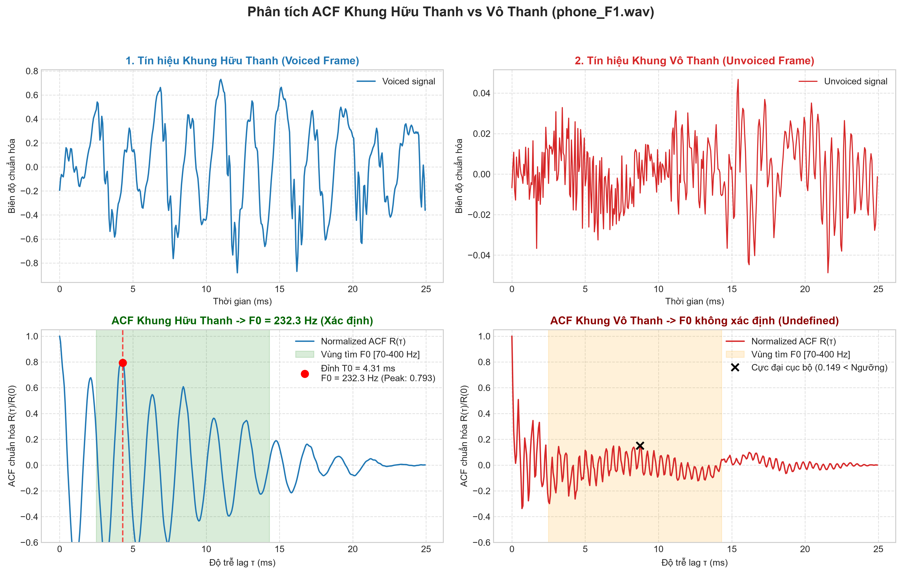
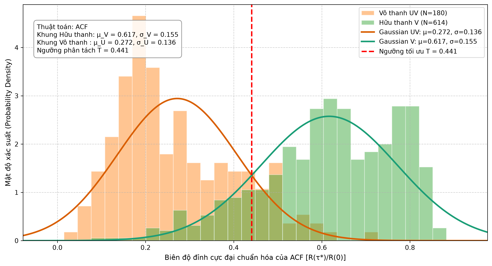
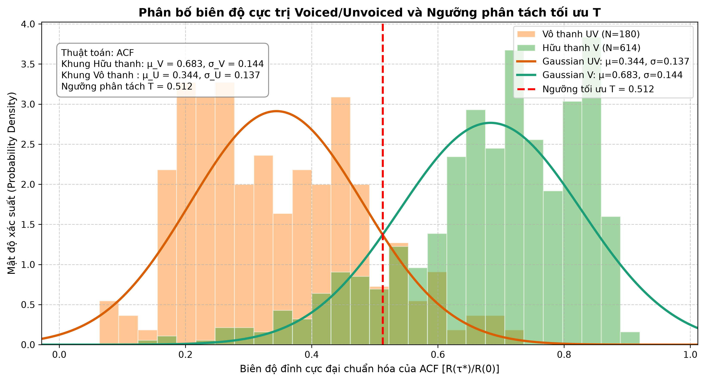
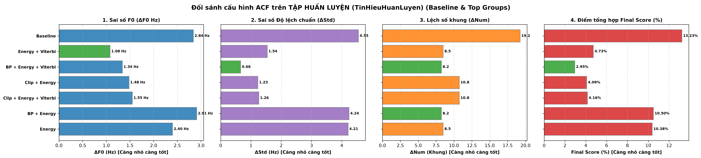

# CHƯƠNG I: THUẬT TOÁN HÀM TỰ TƯƠNG QUAN (AUTOCORRELATION FUNCTION - ACF)

> **Cập nhật 30/10/2026:** Bảng/hình gốc trong chương là kết quả lịch sử. Phần bổ sung cuối chương và [báo cáo đợt 4](STAGE4_RESULTS.md) ghi kết quả hiện hành, giao thức chọn cấu hình trên train và nguyên nhân chênh lệch Cepstrum.

> **Trạng thái sau rà soát 28/10/2026:** Các phân bố Gaussian 614/180 khung trong chương là kết quả lịch sử. LAB hiện hành không có timestamps để huấn luyện lại; các ngưỡng đang được dùng như tham số đã lưu. Xem [các vấn đề cần xử lý](KNOWN_ISSUES.md).

> **Dẫn hướng tài liệu:** [Trang chủ README](../README.md) > **Chương I: Thuật toán ACF**

---

## I.1. Cơ Sở Lý Thuyết Thuật Toán ACF

Hàm tự tương quan (Autocorrelation Function - ACF) đo lường mức độ tương đồng giữa một tín hiệu với chính bản sao trễ thời gian $\tau$ của nó.

Với một khung tín hiệu $x[n]$ gồm $N$ mẫu ($n = 0, 1, \dots, N-1$), hàm tự tương quan chuẩn hóa được định nghĩa:

$$
R(\tau) = \frac{\sum_{n=0}^{N-1-\tau} x[n] \cdot x[n+\tau]}{R(0)}
$$

Trong đó năng lượng của khung là:

$$
R(0) = \sum_{n=0}^{N-1} x^2[n]
$$

Nhờ phép chuẩn hóa qua $R(0)$, biên độ hàm luôn nằm trong đoạn $[-1.0, 1.0]$ và $R(0) = 1.0$.

* **Âm Hữu thanh (Voiced):** Được tạo ra khi dây thanh âm rung động tuần hoàn dưới áp lực luồng khí từ phổi, tạo nên các xung thanh môn lặp lại với chu kỳ cơ bản $T_0$. Hàm $R(\tau)$ sẽ đạt một đỉnh cực đại nổi bật thứ hai tại độ trễ $\tau_0 = T_0 \cdot f_s$. Tần số cơ bản được tính:

$$
F_0 = \frac{f_s}{\tau_0} \quad (\text{Hz})
$$

* **Âm Vô thanh (Unvoiced):** Dây thanh âm không rung, âm thanh được tạo ra do luồng khí xoáy qua chỗ thắt thanh quản. Dạng sóng ngẫu nhiên tựa nhiễu trắng, hàm $R(\tau)$ suy giảm nhanh về 0 và dao động hỗn loạn, không có đỉnh vượt ngưỡng trong dải cao độ người trưởng thành $[70, 400]\text{ Hz}$.

---

## I.2. Minh Họa Khung Hữu Thanh vs Vô Thanh

Thực nghiệm trên file âm thanh `TinHieuHuanLuyen/phone_F1.wav` ($f_s = 16000\text{ Hz}$, khung chuẩn $25\text{ ms} = 400\text{ mẫu}$, dịch $10\text{ ms} = 160\text{ mẫu}$):

### Bảng phân tích chi tiết hai khung đại diện:

| Đặc trưng | Khung Hữu Thanh (Voiced) | Khung Vô Thanh (Unvoiced) |
| :--- | :--- | :--- |
| **Vị trí khung** | Khung #103 ($t = 1.042\text{ s}$) | Khung #176 ($t = 1.772\text{ s}$) |
| **Đặc tính dạng sóng** | Tuần hoàn rõ rệt, biên độ xung thanh môn lớn | Dao động ngẫu nhiên, tựa nhiễu, biên độ thấp |
| **Độ trễ cực đại $\tau_0$** | $\tau_0 = 71$ mẫu | Không có độ trễ tuần hoàn rõ ràng ($\tau = 53$) |
| **Biên độ cực đại $R(\tau_0)$** | **$0.801$** ($\gg T = 0.4408$) | **$0.386$** ($< T = 0.4408$) |
| **Chu kỳ cơ bản $T_0$** | $T_0 = 71 / 16000 = 4.44\text{ ms}$ | Không xác định |
| **Tần số cơ bản $F_0$** | **$F_0 = 225.35\text{ Hz}$** (minh họa khung; LAB hiện hành chỉ có mean toàn file) | **$F_0 = \text{Undefined}$** (Vô thanh) |

---

## I.3. Huấn Luyện Ngưỡng T Tối Ưu Bằng Phân Bố Gauss

Để xác định ngưỡng phân định V/UV dựa trên cơ sở thống kê toán học vững chắc với chiều dài khung chuẩn **$25\text{ ms}$**, đồ án trích xuất biên độ đỉnh ACF lớn nhất của toàn bộ các khung trong 4 file huấn luyện (`phone_F1`, `phone_M1`, `studio_F1`, `studio_M1`), phân chia theo nhãn ground-truth `.lab`:
* Tập khung Hữu thanh: $N_V = 614$ khung $\rightarrow$ phân bố $\mathcal{N}(\mu_V, \sigma_V^2)$
* Tập khung Vô thanh: $N_U = 180$ khung $\rightarrow$ phân bố $\mathcal{N}(\mu_U, \sigma_U^2)$

Ngưỡng tối ưu Bayes $T$ là nghiệm của phương trình giao điểm mật độ xác suất:

$$
\frac{(T - \mu_V)^2}{\sigma_V^2} - \frac{(T - \mu_U)^2}{\sigma_U^2} + 2\ln\left(\frac{\sigma_V}{\sigma_U}\right) = 0
$$

### Bảng kết quả huấn luyện ngưỡng (Khung 25 ms):

| Chế độ tiền xử lý | Số khung Voiced | $\mu_V \pm \sigma_V$ | Số khung Unvoiced | $\mu_U \pm \sigma_U$ | Ngưỡng tối ưu $T$ |
| :--- | :---: | :---: | :---: | :---: | :---: |
| **Baseline (Chưa lọc)** | 614 | $0.6166 \pm 0.1549$ | 180 | $0.2718 \pm 0.1355$ | **$T = 0.4408$** |
| **Có lọc thông dải (Bandpass)** | 614 | $0.6490 \pm 0.1466$ | 180 | $0.3326 \pm 0.1337$ | **$T = 0.4892$** |

### Biểu đồ phân bố xác suất Gaussian:

| Baseline (Chưa lọc: $T = 0.4408$) | Có lọc Bandpass (Đã lọc: $T = 0.4892$) |
| :---: | :---: |
|  |  |

---

## I.4. Khảo sát khung và đánh giá kiểm thử

Cấu hình hiện tại dùng khung 25 ms và hop 10 ms. Bảng so sánh 20/25/30 ms trước đây dùng nhãn có timestamps và giá trị tham chiếu khác; đã chuyển vào [bản lưu lịch sử](../archive/2026-10-28-pre-cleanup/README.md).

Script `03_compare_params.py` còn lỗi định dạng chỉ số None khi LAB không có segments; xem [danh sách cần sửa](KNOWN_ISSUES.md). Không dùng Accuracy/F1 lịch sử để đánh giá dữ liệu hiện hành.

Kết quả test tập trung tại [Chương IV](04_test_set_benchmark_and_analysis.md) và `outputs/reports/compare_acf_amdf_cepstrum.json`.

---

## I.6. Các Giải Pháp Cải Tiến Dành Riêng Cho ACF (Plugins)

### I.6.1. Plugin 1: Ngưỡng trễ kép Hysteresis (Schmitt Trigger)

**Vấn đề giải quyết:**  
Hiện tượng rung lật trạng thái (*decision chattering*) khi đỉnh tự tương quan dao động quanh ngưỡng tĩnh $T$.

**Mô hình máy trạng thái:**  
Ký hiệu $S_i \in \lbrace 0, 1 \rbrace$ là nhãn khung thứ $i$ (0: Unvoiced, 1: Voiced) và $R_i^* = \max_{\tau \in [\tau_{\min}, \tau_{\max}]} R_i(\tau)$ là đỉnh cực đại tự tương quan.

Phương trình chuyển trạng thái:

$$
S_i = \begin{cases} 
1, & \text{khi } R_i^* \ge T_{\text{high}} \\
1, & \text{khi } S_{i-1} = 1 \text{ và } R_i^* \ge T_{\text{low}} \\
0, & \text{ngược lại}
\end{cases}
$$

**Thông số áp dụng:**  
* Mô hình Baseline: $T_{\text{high}} = 0.4408, T_{\text{low}} = 0.40$
* Mô hình Bandpass: $T_{\text{high}} = 0.4892, T_{\text{low}} = 0.42$

---

### I.6.2. Plugin 2: Mở rộng vùng hữu thanh theo năng lượng khung biên (STE)

**Vấn đề giải quyết:**  
Khắc phục tình trạng mất 1–2 khung ở mép âm tiết khi thanh môn bắt đầu khép hoặc hạ giọng.

**Công thức toán học:**  
Năng lượng ngắn hạn (Short-Time Energy - STE) của khung thứ $i$:

$$
E_i = \sum_{n=0}^{N-1} x_i^2[n]
$$

Với đoạn hữu thanh liên tục $C_k = [i_{\text{start}}, i_{\text{end}}]$, năng lượng đỉnh trong phân đoạn là:

$$
E_{\max}^{(k)} = \max_{j \in C_k} E_j
$$

Khung biên lân cận ($i_{\text{start}} - 1$ hoặc $i_{\text{end}} + 1$) được mở rộng thành Voiced nếu thỏa mãn đồng thời:

$$
\begin{cases} 
E_{\text{boundary}} \ge \alpha \cdot E_{\max}^{(k)} & (\alpha = 0.20) \\
R_{\text{boundary}}^* \ge (1 - \beta) \cdot T & (\beta = 0.20) 
\end{cases}
$$

---

### I.6.3. Plugin 3: Bộ lọc thông dải Butterworth & Lọc Zero-Phase

**Vấn đề giải quyết:**  
Triệt tiêu trôi DC, tiếng ù gió micro ($< 70\text{ Hz}$) và các sóng hài formant bậc cao ($> 900\text{ Hz}$) gây lỗi Pitch Doubling.

**Hàm truyền biên độ bình phương:**  
Bộ lọc thông dải Butterworth bậc $M = 2$ với dải thông $[f_L, f_H] = [70, 900]\text{ Hz}$:

$$
|H(j\omega)|^2 = \frac{1}{1 + \left(\frac{\omega^2 - \omega_L \omega_H}{\omega (\omega_H - \omega_L)}\right)^{4}}
$$

**Lọc hai chiều không lệch pha (Zero-Phase Filtering):**  
Sử dụng kỹ thuật `filtfilt` để triệt tiêu hoàn toàn độ trễ pha:

$$
Y(e^{j\omega}) = |H(e^{j\omega})|^2 X(e^{j\omega}) \implies \Theta(\omega) = 0
$$

Độ lệch pha bằng 0 tuyệt đối tại mọi tần số, bảo toàn nguyên vẹn vị trí thời gian của các đỉnh xung thanh môn $T_0$.

**Đồng bộ phân bố:**  
Do lọc làm sạch tín hiệu, $\mu_V$ tăng từ $0.6166 \rightarrow 0.6490$, hệ thống tự động đồng bộ ngưỡng tối ưu mới:

$$
T = 0.4892
$$

---

### I.6.4. Plugin 4: Cắt gọt trung tâm (Center Clipping - Sondhi 1968)

**Vấn đề giải quyết:**  
Triệt tiêu hoàn toàn thành phần dao động cộng hưởng của thanh đạo (Formant $F_1, F_2$) gây biến dạng đỉnh tự tương quan và sinh ra các đỉnh phụ lồi lõm (nguyên nhân chính gây lỗi nhảy quãng tám Pitch Doubling).

**Nguyên lý làm phẳng phổ (Spectral Flattening):**  
Với mỗi khung tín hiệu $x[n]$, xác định mức cắt $C_L = \eta \cdot \max_{n} |x[n]|$ (thực nghiệm tối ưu $\eta = 0.40$). Biến đổi cắt gọt Sondhi chuẩn:

$$
y[n] = \begin{cases} 
x[n] - C_L & \text{nếu } x[n] > C_L \\ 
x[n] + C_L & \text{nếu } x[n] < -C_L \\ 
0 & \text{nếu } |x[n]| \le C_L 
\end{cases}
$$

**Đồng bộ phân bố ngưỡng tối ưu Gauss:**  
Khi các mẫu biên độ nhỏ bị gán về $0$, phân bố tương quan thay đổi:
* Nhóm Center Clip độc lập: $\mu_V = 0.5188, \mu_U = 0.1759 \implies T = 0.3352$
* Nhóm kết hợp Bandpass + Center Clip: $\mu_V = 0.5801, \mu_U = 0.2230 \implies T = 0.3953$

---

### I.6.5. Plugin 5: Quy hoạch động Viterbi Tracking (Dynamic Programming Pitch Tracking)

**Vấn đề giải quyết:**  
Các thuật toán dò cực trị cục bộ (ACF, AMDF) chỉ xét từng khung độc lập nên dễ mắc lỗi **nhảy quãng tám (Pitch Doubling / Halving)** hoặc bắt nhầm đỉnh formant do sóng hài phụ khi biên độ của đỉnh sai cao hơn đỉnh thật chỉ $0.02 - 0.05$. Bộ lọc trung vị (Median Filter) chỉ sửa được các lỗi 1 khung đơn lẻ, bất lực nếu lỗi kéo dài 2-3 khung liên tiếp.

**Cơ chế sinh lý học & Không gian trạng thái Trellis:**  
Dây thanh âm là cơ quan cơ học sinh học có quán tính, không thể biến thiên tần số đột ngột trong $10\text{ ms}$. Tại mỗi khung hữu thanh, plugin trích xuất Top-5 cực trị tốt nhất ($K=5$) để xây dựng lưới không gian trạng thái.

**Hàm chi phí Trellis (Cost Function):**

* **Chi phí cục bộ ($C_{\text{local}}$):** Đo lường độ tin cậy của ứng viên tại khung $t$:

$$
C_{\text{local}}(\tau) = 1.0 - R_{\text{norm}}(\tau) \quad (\text{với ACF})
$$

* **Chi phí chuyển tiếp ($C_{\text{trans}}$):** Phạt bước nhảy tần số theo thang Logarithm cơ số 2 (Octave):

$$
C_{\text{trans}}(s_{t-1}, s_t) = w_{\text{freq}} \cdot \left( \log_2(F_{0, t}) - \log_2(F_{0, t-1}) \right)^2
$$

Nếu bước nhảy rơi vào vùng nhảy quãng tám ($[0.8, 1.2]\text{ octave}$), áp dụng mức phạt bổ sung $w_{\text{octave}} = 2.0$.

**Thuật toán Viterbi:** Lan truyền tiến tìm đường đi có tổng chi phí nhỏ nhất và truy vết ngược (Backtracking) để thu được chuỗi cao độ tối ưu toàn cục.

---

## I.7. Khảo Sát & Phân Nhóm Cấu Hình Tối Ưu Cho ACF Trên Tập Huấn Luyện (TinHieuHuanLuyen)

Toàn bộ quá trình thử nghiệm, tinh chỉnh siêu tham số và lựa chọn cấu hình tối ưu được thực hiện nghiêm ngặt trên **Tập Huấn Luyện (TinHieuHuanLuyen)** gồm 4 file chuẩn (phone_F1, phone_M1, studio_F1, studio_M1). Hệ thống quét qua 16 tổ hợp plugin (Bandpass Filter, Center Clipping, Energy Extension, Viterbi Tracking) và phân nhóm thành 4 nhóm mục tiêu:

### Bảng kết quả phân nhóm tối ưu cho thuật toán ACF (Tập Huấn Luyện):

| Phân nhóm chỉ số | Cấu hình Plugin | $\Delta F_0$ (Hz) | MAPE $ (%) | $\Delta\text{Std}$ (Hz) | MAPE Std (%) | $\Delta\text{Num}$ (Khung) | MAPE Num (%) | FINAL SCORE (%) |
| :--- | :--- | :---: | :---: | :---: | :---: | :---: | :---: | :---: |
| **Baseline (Gốc)** | Baseline | 2.84 Hz | 1.95% | 4.55 Hz | 25.21% | 19.2 khung | 12.53% | **13.23%** |
| **Nhóm 1 (Top 1 F0)** | Energy + Viterbi | **1.08 Hz** | **0.54%** | 1.54 Hz | 7.63% | 8.5 khung | 6.01% | 4.73% |
| **Nhóm 1 (Top 2 F0)** | BP + Energy + Viterbi | 1.34 Hz | 0.64% | **0.66 Hz** | **2.39%** | **8.2 khung** | **5.83%** | **2.95%** 🏆 |
| **Nhóm 1 (Top 3 F0)** | Clip + Energy | 1.48 Hz | 0.82% | 1.23 Hz | 4.21% | 10.8 khung | 7.23% | 4.09% |
| **Nhóm 2 (Top 1 Std)** | BP + Energy + Viterbi | 1.34 Hz | 0.64% | **0.66 Hz** | **2.39%** | **8.2 khung** | **5.83%** | **2.95%** 🏆 |
| **Nhóm 2 (Top 2 Std)** | Clip + Energy | 1.48 Hz | 0.82% | 1.23 Hz | 4.21% | 10.8 khung | 7.23% | 4.09% |
| **Nhóm 2 (Top 3 Std)** | Clip + Energy + Viterbi | 1.55 Hz | 0.85% | 1.26 Hz | 4.39% | 10.8 khung | 7.23% | 4.16% |
| **Nhóm 3 (Top 1 Num)** | BP + Energy | 2.91 Hz | 1.92% | 4.24 Hz | 23.74% | **8.2 khung** | **5.83%** | 10.50% |
| **Nhóm 3 (Top 2 Num)** | BP + Energy + Viterbi | 1.34 Hz | 0.64% | **0.66 Hz** | **2.39%** | **8.2 khung** | **5.83%** | **2.95%** 🏆 |
| **Nhóm 3 (Top 3 Num)** | Energy | 2.40 Hz | 1.62% | 4.21 Hz | 23.50% | 8.5 khung | 6.01% | 10.38% |
| **Nhóm 4 (Top 1 Toàn diện)** | BP + Energy + Viterbi | **1.34 Hz** | **0.64%** | **0.66 Hz** | **2.39%** | **8.2 khung** | **5.83%** | **2.95%** 🏆 |
| **Nhóm 4 (Top 2 Toàn diện)** | Clip + Energy | 1.48 Hz | 0.82% | 1.23 Hz | 4.21% | 10.8 khung | 7.23% | 4.09% |
| **Nhóm 4 (Top 3 Toàn diện)** | Clip + Energy + Viterbi | 1.55 Hz | 0.85% | 1.26 Hz | 4.39% | 10.8 khung | 7.23% | 4.16% |

### Bảng đối sánh chi tiết 4 file huấn luyện: ACF Baseline vs ACF Top 1 Champion [BP + Energy + Viterbi]:

| File huấn luyện | Cấu hình | Ref $ | Pred $ | $\lvert\Delta F_0\rvert$ | MAPE $ | Ref Std | Pred Std | $\lvert\Delta\text{Std}\rvert$ | MAPE Std | Ref Num | Pred Num | $\lvert\Delta\text{Num}\rvert$ | MAPE Num | **FINAL SCORE** |
| :--- | :--- | :---: | :---: | :---: | :---: | :---: | :---: | :---: | :---: | :---: | :---: | :---: | :---: | :---: |
| phone_F1.wav | Baseline | 215.60 Hz | 217.71 Hz | 2.11 Hz | 0.98% | 20.60 | 20.51 | 0.09 | 0.43% | 148 | 132 | 16 | 10.81% | **4.07%** |
| | **Champion** | 215.60 Hz | 217.12 Hz | **1.52 Hz** | **0.71%** | 20.60 | 20.96 | 0.36 | 1.75% | 148 | 136 | **12** | **8.11%** | **3.52%** |
| phone_M1.wav | Baseline | 123.70 Hz | 130.91 Hz | 7.21 Hz | 5.83% | 16.80 | 32.20 | 15.40 | 91.65% | 232 | 193 | 39 | 16.81% | **38.10%** |
| | **Champion** | 123.70 Hz | 123.62 Hz | **0.08 Hz** | **0.06%** | 16.80 | 16.94 | **0.14** | **0.83%** | 232 | 221 | **11** | **4.74%** | **1.88%** 🏆 |
| studio_F1.wav| Baseline | 229.60 Hz | 231.39 Hz | 1.79 Hz | 0.78% | 36.80 | 35.44 | 1.36 | 3.69% | 127 | 117 | 10 | 7.87% | **4.11%** |
| | **Champion** | 229.60 Hz | 232.98 Hz | 3.38 Hz | 1.47% | 36.80 | 35.76 | **1.04** | **2.83%** | 127 | 123 | **4** | **3.15%** | **2.48%** 🏆 |
| studio_M1.wav| Baseline | 116.90 Hz | 116.64 Hz | 0.26 Hz | 0.22% | 26.40 | 25.06 | 1.34 | 5.07% | 82 | 70 | 12 | 14.63% | **6.64%** |
| | **Champion** | 116.90 Hz | 117.29 Hz | 0.39 Hz | 0.33% | 26.40 | 25.30 | **1.10** | **4.15%** | 82 | 76 | **6** | **7.32%** | **3.93%** |
| **TRUNG BÌNH** | Baseline | — | — | 2.84 Hz | 1.95% | — | — | 4.55 | 25.21% | — | — | 19.2 | 12.53% | **13.23%** |
| | **Champion** | — | — | **1.34 Hz** | **0.64%** | — | — | **0.66** | **2.39%** | — | — | **8.2** | **5.83%** | **2.95%** 🏆 |

### Biểu đồ các cấu hình đại diện từ khảo sát 16 tổ hợp ACF:

Các hình so sánh cấu hình cũ đã được chuyển vào [archive](../archive/2026-10-28-pre-cleanup/README.md). Cách tạo dự đoán mới được trình bày trong [hướng dẫn kiểm thử](TESTING.md).

---

**Dẫn hướng:** [Trang chủ README](../README.md) | [Chương II: Thuật toán AMDF →](02_amdf_theory_and_experiments.md)

<!-- STAGE4_CURRENT_START -->
## Kết quả kiểm chứng hiện hành — 30/10/2026

Nguồn: cấu hình đóng băng và `outputs/stage4_validation/evaluation.json`. Final Score là sai số thống kê toàn file; thấp hơn tốt hơn. Accuracy/F1 từng khung không xác định vì thiếu nhãn thời gian.

Preset: BP + Energy + Viterbi, frame/hop 30/10 ms, T=0.45.

| Cấu hình | Train (%) | Test (%) |
|---|---:|---:|
| baseline | 13.887 | 5.822 |
| historical_champion | 3.880 | 4.223 |
| selected_champion | 2.215 | 2.385 |

| File test | Mean dự đoán (Hz) | Std dự đoán (Hz) | Khung voiced | Final Score (%) |
|---|---:|---:|---:|---:|
| phone_F2.wav | 150.98 | 31.38 | 203 | 3.35 |
| phone_M2.wav | 132.19 | 15.83 | 124 | 1.71 |
| studio_F2.wav | 201.64 | 45.45 | 136 | 2.87 |
| studio_M2.wav | 156.10 | 30.15 | 120 | 1.61 |

[Chi tiết và giới hạn kiểm chứng](STAGE4_RESULTS.md).
<!-- STAGE4_CURRENT_END -->
