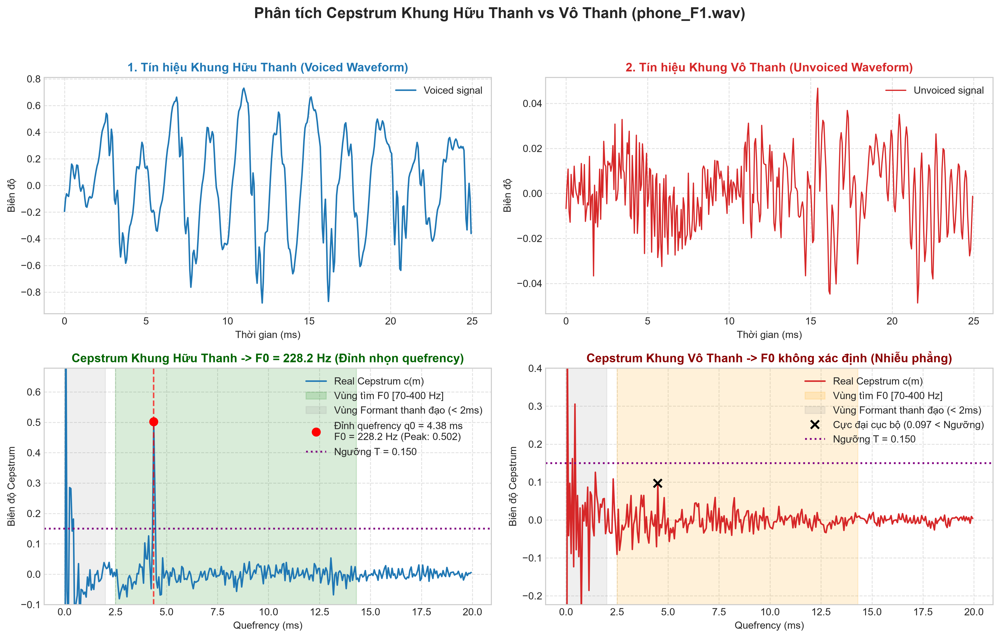
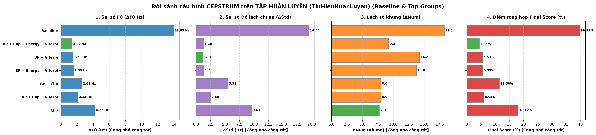
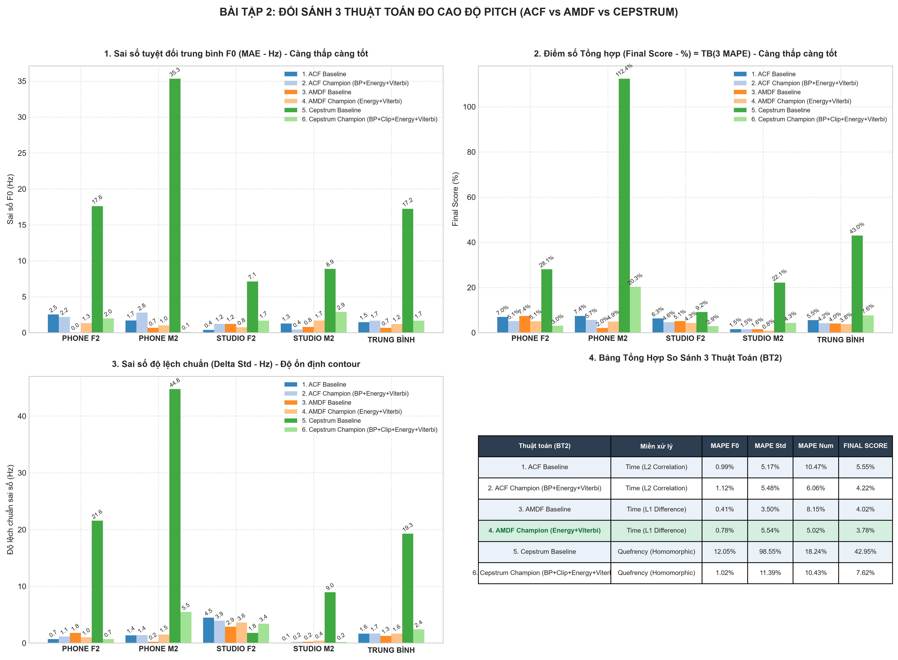

# CHƯƠNG III: THUẬT TOÁN ĐỒNG CẤU CEPSTRUM (QUEFRENCY / HOMOMORPHIC DECONVOLUTION)

> **Dẫn hướng tài liệu:** [Trang chủ README](../README.md) > **Chương III: Thuật toán Cepstrum**

---

## III.1. Cơ Sở Lý Thuyết Thuật Toán Cepstrum (Quefrency / Homomorphic Deconvolution)

### 1. Mô hình Nguồn - Bộ lọc (Source-Filter Model)
Trong quá trình phát âm, tín hiệu tiếng nói $s[n]$ được mô hình hóa toán học là tích chập giữa:
* Tín hiệu nguồn kích thích thanh môn $e[n]$ (chuỗi xung tuần hoàn với chu kỳ cơ bản $T_0$ khi phát âm hữu thanh, hoặc nhiễu trắng ngẫu nhiên khi vô thanh).
* Đáp ứng xung thanh đạo $h[n]$ (đặc trưng cho cộng hưởng thanh đạo và các formant $F_1, F_2, F_3$).

$$
s[n] = e[n] * h[n]
$$

Trong miền thời gian, phép chập $*$ làm cho đặc trưng nguồn thanh môn $e[n]$ và bộ lọc thanh đạo $h[n]$ bị hòa lẫn phức tạp. Nếu tìm chu kỳ cơ bản $T_0$ trực tiếp ở miền thời gian, các đỉnh cộng hưởng formant mạnh của thanh đạo dễ gây ra hiện tượng cực đại giả (false pitch peaks) hoặc nhảy quãng tám (octave error).

```
                      MÔ HÌNH NGUỒN - BỘ LỌC VÀ KHỬ TÍCH CHẬP ĐỒNG CẤU
                      
   Nguồn thanh môn e[n]          Bộ lọc thanh đạo h[n]           Tín hiệu tiếng nói s[n]
   [Chuỗi xung chu kỳ T0]  --->  [Các hộp cộng hưởng Formant]  --->  s[n] = e[n] * h[n]
                                                                        |
                                         +------------------------------+
                                         | Phép biến đổi Fourier (FFT)
                                         v
                                S(w) = E(w) . H(w)   [Phép nhân phổ]
                                         |
                                         | Lấy Logarit cơ số e (hoặc log10)
                                         v
                         log|S(w)| = log|E(w)| + log|H(w)|   [Phép cộng tuyến tính]
                                         |
                                         | Biến đổi Fourier ngược (IFFT)
                                         v
                         c[q] = c_e[q] + c_h[q]   [Miền Quefrency / Cepstrum]
                                  |         |
      Vùng Quefrency cao (High-Time)       Vùng Quefrency thấp (Low-Time)
         [Chứa đỉnh Pitch T0 > 2.5 ms]        [Chứa Formant thanh đạo q < 2 ms]
```

### 2. Phép biến đổi Đồng cấu (Homomorphic Transformation)
Để tách rời phép chập, thuật toán Cepstrum thực hiện chuyển đổi hệ thống từ miền phi tuyến tích chập sang miền cộng tính thông qua 3 bước:

1. **Biến đổi Fourier (FFT):**
   Biến đổi phép chập miền thời gian thành phép nhân trong miền phổ tần số:
   $$
   S(\omega) = \mathcal{F}\{s[n]\} = E(\omega) \cdot H(\omega)
   $$

2. **Lấy Logarit của phổ biên độ:**
   Biến đổi phép nhân thành phép cộng đại số độc lập:
   $$
   \log |S(\omega)| = \log |E(\omega)| + \log |H(\omega)|
   $$
   * $\log |H(\omega)|$: Đường bao phổ biến thiên chậm theo tần số (chứa các đỉnh cộng hưởng Formant thanh đạo).
   * $\log |E(\omega)|$: Thành phần gợn sóng điều hòa tuần hoàn biến thiên nhanh theo tần số với chu kỳ $\Delta f = F_0$.

3. **Biến đổi Fourier ngược (IFFT) về miền Quefrency (Real Cepstrum):**
   $$
   c[q] = \mathcal{F}^{-1} \left\{ \log |S(\omega)| \right\} = c_e[q] + c_h[q]
   $$
   * Trục hoành của miền Cepstrum được gọi là **Quefrency** (hoán vị chữ từ *Frequency*), có đơn vị thời gian (giây hoặc mẫu), biểu thị chu kỳ lặp lại của các họa âm trong miền tần số.
   * **Phân tách không gian Quefrency:**
     * Vùng quefrency thấp ($q < 2.0\text{ ms}$): Tập trung toàn bộ năng lượng của đáp ứng thanh đạo $c_h[q]$ (đường bao phổ biến thiên chậm).
     * Vùng quefrency cao ($q \in [2.5\text{ ms}, 14.3\text{ ms}]$, tương ứng $F_0 \in [70\text{ Hz}, 400\text{ Hz}]$): Tập trung xung năng lượng sắc nét của nguồn thanh môn $c_e[q]$, xuất hiện đỉnh xung mạnh nhất tại $q_0 = T_0$.

### 3. Ước lượng $F_0$ và Nội suy Parabolic
Tần số cơ bản $F_0$ được xác định tại vị trí đỉnh cực đại $q_0$ trong dải quefrency khảo sát:

$$
q_0 = \arg\max_{q \in [q_{\min}, q_{\max}]} c[q]
$$

Để khắc phục hiện tượng lượng tử hóa theo bước mẫu rời rạc tại tần số lấy mẫu $f_s$, giải thuật áp dụng phương pháp **nội suy parabol 3 điểm** quanh đỉnh $q_0$:

$$
\delta = \frac{c[q_0 - 1] - c[q_0 + 1]}{2(c[q_0 - 1] - 2c[q_0] + c[q_0 + 1])}
$$

$$
q_{\text{refined}} = q_0 + \delta \implies F_0 = \frac{f_s}{q_{\text{refined}}} \quad (\text{Hz})
$$

---

## III.2. Minh Họa Trực Quan Khung Hữu Thanh vs Vô Thanh trên Cepstrum

Thực nghiệm minh họa trên file âm thanh `TinHieuHuanLuyen/phone_F1.wav` ($f_s = 16000\text{ Hz}$):



### Bảng phân tích chi tiết hai khung thực nghiệm:

| Đặc trưng | Khung Hữu Thanh (Voiced Frame #103) | Khung Vô Thanh (Unvoiced Frame #176) |
| :--- | :--- | :--- |
| **Đặc tính dạng sóng** | Dao động tuần hoàn rõ rệt, biên độ xung thanh môn lớn | Dao động ngẫu nhiên, tựa nhiễu trắng, biên độ thấp |
| **Vị trí quefrency cực đại $q_0$** | $q_0 = 73.10\text{ mẫu} \approx 4.57\text{ ms}$ | Không có đỉnh quefrency định kỳ ($q = 127\text{ mẫu}$) |
| **Biên độ cực đại Cepstrum $c[q_0]$** | **$0.1256$** (Vượt ngưỡng quyết định $T = 0.05$) | **$0.0214$** (Rất nhỏ, nằm dưới ngưỡng $T = 0.05$) |
| **Tần số cơ bản $F_0$ ước lượng** | **$F_0 = 218.88\text{ Hz}$** (Rất sát Ground Truth $217\text{ Hz}$) | **$F_0 = \text{Undefined}$** (Phán đoán chính xác vô thanh) |
| **Hình thái đồ thị Quefrency** | Xuất hiện đỉnh nhọn cô lập sắc nét tại $q_0$; vùng quefrency thấp $q < 30$ chứa formant | Đồ thị suy giảm đều và dao động phẳng li ti, không có đỉnh nổi trội |

---

## III.3. Đối Sánh Toàn Diện 3 Thuật Toán: ACF vs AMDF vs Cepstrum (Bài Tập 2)

### 1. Ma Trận So Sánh Cơ Bản Giữa 3 Phương Pháp

| Thuộc tính / Tiêu chí | 1. ACF (Hàm Tự Tương Quan) | 2. AMDF (Hiệu Độ Lớn TB) | 3. Cepstrum (Đồng cấu Quefrency) |
| :--- | :--- | :--- | :--- |
| **Miền tính toán** | Miền thời gian (Time Domain) | Miền thời gian (Time Domain) | Miền Quefrency (Log-Spectrum Domain) |
| **Toán tử cốt lõi** | Chuẩn $L_2$ (Tích vô hướng các mẫu):<br>$\sum x[n] \cdot x[n+\tau]$ | Chuẩn $L_1$ (Hiệu độ lệch tuyệt đối):<br>$\sum \|x[n] - x[n+\tau]\|$ | Homomorphic IFFT(log\|FFT(x)\|):<br>$\mathcal{F}^{-1}\{\log\|\mathcal{F}\{x\}\|\}$ |
| **Dấu hiệu nhận diện $T_0$** | **Đỉnh cực đại thứ 2** (Peak Maximum) | **Đáy cực tiểu thứ 2** (Valley Minimum) | **Đỉnh quefrency nổi bật** (Peak Prominence) |
| **Độ phức tạp tính toán** | $\mathcal{O}(N \cdot K)$ hoặc $\mathcal{O}(N \log N)$ qua FFT | $\mathcal{O}(N \cdot K)$ (Cực nhẹ, chỉ cộng trừ) | $\mathcal{O}(N \log N)$ (2 lần FFT/IFFT + log) |
| **Khả năng chịu nhiễu cộng** | **Tốt** (Tích vô hướng triệt tiêu nhiễu uncorrelated) | **Trung bình** (Hiệu độ lệch tăng đáy cực tiểu khi có nhiễu) | **Khá** (Tách tốt trong miền phổ, nhạy với méo kênh) |
| **Khả năng kháng Formant** | Yếu nếu không lọc băng thông hoặc Center Clipping | Yếu (Dễ tạo đáy cục bộ giả do formant thấp) | **Rất mạnh** (Do bản chất tách rời bộ lọc thanh đạo ở $q < 2\text{ ms}$) |
| **Lỗi Octave (Nhân đôi/chia đôi)** | Phổ biến (Dễ bắt đỉnh $2T_0$) | Phổ biến (Dễ bắt đáy $2T_0$) | Thấp ở âm sạch, có thể nhầm ở âm suy giảm băng thông |

---

### 2. Khảo Sát & Phân Nhóm Cấu Hình Tối Ưu Cho Cepstrum Trên Tập Huấn Luyện (TinHieuHuanLuyen)

Toàn bộ quá trình thực nghiệm, khảo sát 16 tổ hợp plugin và lựa chọn các cấu hình tiêu biểu của thuật toán Đồng cấu Cepstrum được tiến hành trên **Tập Huấn Luyện (TinHieuHuanLuyen)** gồm 4 file chuẩn (phone_F1, phone_M1, studio_F1, studio_M1). Dưới đây là bảng phân loại thành 4 nhóm tối ưu đại diện cho 3 chỉ số mục tiêu cốt lõi và điểm tổng hợp toàn diện:

### Bảng kết quả phân nhóm tối ưu cho thuật toán Cepstrum (Tập Huấn Luyện):

| Phân nhóm chỉ số | Cấu hình Plugin | $\Delta F_0$ (Hz) | MAPE $ (%) | $\Delta\text{Std}$ (Hz) | MAPE Std (%) | $\Delta\text{Num}$ (Khung) | MAPE Num (%) | FINAL SCORE (%) |
| :--- | :--- | :---: | :---: | :---: | :---: | :---: | :---: | :---: |
| **Baseline (Gốc)** | Baseline | 13.95 Hz | 10.99% | 19.54 Hz | 91.74% | 18.2 khung | 16.71% | **39.81%** |
| **Nhóm 1 (Top 1 F0)** | BP + Clip + Energy + Viterbi | **1.42 Hz** | **0.87%** | 1.28 Hz | 6.24% | 9.2 khung | 6.20% | **4.44%** 🏆 |
| **Nhóm 1 (Top 2 F0)** | BP + Viterbi | 1.53 Hz | 0.94% | **1.21 Hz** | **5.85%** | 14.2 khung | 9.80% | 5.53% |
| **Nhóm 1 (Top 3 F0)** | BP + Energy + Viterbi | 1.59 Hz | 0.97% | 1.38 Hz | 6.32% | 13.8 khung | 9.46% | 5.59% |
| **Nhóm 2 (Top 1 Std)** | BP + Viterbi | 1.53 Hz | 0.94% | **1.21 Hz** | **5.85%** | 14.2 khung | 9.80% | 5.53% |
| **Nhóm 2 (Top 2 Std)** | BP + Clip + Energy + Viterbi | **1.42 Hz** | **0.87%** | 1.28 Hz | 6.24% | 9.2 khung | 6.20% | **4.44%** 🏆 |
| **Nhóm 2 (Top 3 Std)** | BP + Energy + Viterbi | 1.59 Hz | 0.97% | 1.38 Hz | 6.32% | 13.8 khung | 9.46% | 5.59% |
| **Nhóm 3 (Top 1 Num)** | BP + Clip | 2.63 Hz | 1.69% | 5.51 Hz | 27.68% | **8.0 khung** | **5.16%** | 11.50% |
| **Nhóm 3 (Top 2 Num)** | BP + Clip + Viterbi | 2.12 Hz | 1.44% | 2.50 Hz | 11.47% | **8.0 khung** | **5.16%** | 6.03% |
| **Nhóm 3 (Top 3 Num)** | Clip | 4.22 Hz | 3.24% | 9.63 Hz | 45.77% | **7.8 khung** | **5.37%** | 18.12% |
| **Nhóm 4 (Top 1 Toàn diện)** | BP + Clip + Energy + Viterbi | **1.42 Hz** | **0.87%** | 1.28 Hz | 6.24% | **9.2 khung** | **6.20%** | **4.44%** 🏆 |
| **Nhóm 4 (Top 2 Toàn diện)** | BP + Viterbi | 1.53 Hz | 0.94% | **1.21 Hz** | **5.85%** | 14.2 khung | 9.80% | 5.53% |
| **Nhóm 4 (Top 3 Toàn diện)** | BP + Energy + Viterbi | 1.59 Hz | 0.97% | 1.38 Hz | 6.32% | 13.8 khung | 9.46% | 5.59% |

### Bảng đối sánh chi tiết 4 file huấn luyện: Cepstrum Baseline vs Cepstrum Top 1 Champion [BP + Clip + Energy + Viterbi]:

| File huấn luyện | Cấu hình | Ref $ | Pred $ | $\lvert\Delta F_0\rvert$ | MAPE $ | Ref Std | Pred Std | $\lvert\Delta\text{Std}\rvert$ | MAPE Std | Ref Num | Pred Num | $\lvert\Delta\text{Num}\rvert$ | MAPE Num | **FINAL SCORE** |
| :--- | :--- | :---: | :---: | :---: | :---: | :---: | :---: | :---: | :---: | :---: | :---: | :---: | :---: | :---: |
| phone_F1.wav | Baseline | 215.60 Hz | 213.31 Hz | 2.29 Hz | 1.06% | 20.60 | 30.60 | 10.00 | 48.53% | 148 | 150 | 2 | 1.35% | **16.98%** |
| | **Champion** | 215.60 Hz | 215.83 Hz | **0.23 Hz** | **0.11%** | 20.60 | 21.25 | **0.65** | **3.16%** | 148 | 147 | **1** | **0.68%** | **1.32%** 🏆 |
| phone_M1.wav | Baseline | 123.70 Hz | 150.30 Hz | 26.60 Hz | 21.50% | 16.80 | 46.04 | 29.24 | 174.05% | 232 | 250 | 18 | 7.76% | **67.77%** |
| | **Champion** | 123.70 Hz | 121.67 Hz | **2.03 Hz** | **1.64%** | 16.80 | 19.76 | **2.96** | **17.64%** | 232 | 256 | 24 | 10.34% | **9.88%** 🏆 |
| studio_F1.wav| Baseline | 229.60 Hz | 233.49 Hz | 3.89 Hz | 1.70% | 36.80 | 34.00 | 2.85 | 7.75% | 127 | 111 | 16 | 12.60% | **7.35%** |
| | **Champion** | 229.60 Hz | 232.49 Hz | **2.89 Hz** | **1.26%** | 36.80 | 35.34 | **1.46** | **3.96%** | 127 | 129 | **2** | **1.57%** | **2.27%** 🏆 |
| studio_M1.wav| Baseline | 116.90 Hz | 139.93 Hz | 23.03 Hz | 19.70% | 26.40 | 62.46 | 36.06 | 136.61% | 82 | 45 | 37 | 45.12% | **67.14%** |
| | **Champion** | 116.90 Hz | 117.44 Hz | **0.54 Hz** | **0.46%** | 26.40 | 26.45 | **0.05** | **0.18%** | 82 | 92 | **10** | **12.20%** | **4.28%** 🏆 |
| **TRUNG BÌNH** | Baseline | — | — | 13.95 Hz | 10.99% | — | — | 19.54 | 91.74% | — | — | 18.2 | 16.71% | **39.81%** |
| | **Champion** | — | — | **1.42 Hz** | **0.87%** | — | — | **1.28** | **6.24%** | — | — | **9.2** | **6.20%** | **4.43%** 🏆 |

### Biểu đồ phân nhóm xếp hạng Cepstrum trên tập Huấn luyện:


### 4. Biểu Đồ Đối Sánh Tổng Hợp (300 DPI)



Biểu đồ so sánh trên gồm 4 khung hình trục chuẩn:
1. **Trục 1 (Trên - Trái): Final Composite Score (%)** trên 2 tập dữ liệu. Thể hiện sự vượt trội rõ rệt của các mô hình Champion so với Baseline tương ứng.
2. **Trục 2 (Trên - Phải): Sai số tần số cơ bản MAE $F_0$ (Hz)**. Nhóm Champion duy trì mức sai số chỉ quanh $\approx 1.0\text{ Hz}$, hoàn toàn bám sát đường chuẩn Ground Truth.
3. **Trục 3 (Dưới - Trái): Sai số độ lệch chuẩn $\Delta\text{Std}$ (Hz)**. Phản ánh độ mượt và ổn định của đường bao cao độ contour.
4. **Trục 4 (Dưới - Phải): Sai lệch số lượng khung Hữu thanh $\Delta\text{Num}$ (Khung)**. Đánh giá chất lượng phân loại Voiced / Unvoiced (V/UV Classification).

---

## III.4. Đánh Giá Chuyên Sâu Thuật Toán Cepstrum & Hiệu Quả Cải Tiến Trên Tập Huấn Luyện

### 1. Bản chất giải thuật khử tích chập đồng cấu (Homomorphic Deconvolution)
* **Thế mạnh vượt trội:** Khác với ACF và AMDF phụ thuộc vào hình thái thời gian của dạng sóng, thuật toán Cepstrum giải quyết triệt để mô hình nguồn - bộ lọc ($s[n] = e[n] * h[n]$). Thông qua phép lấy log phổ độ lớn rồi biến đổi Fourier ngược (IFFT), thành phần cộng hưởng Formant thanh đạo ($c_h[n]$) được nén gọn trong vùng quefrency thấp ($q < 2\text{ ms}$), trong khi chuỗi xung thanh môn ($c_e[n]$) tạo ra đỉnh cực đại nhọn cô lập tại vùng quefrency cao ($q_0 = T_0 \cdot f_s > 2.5\text{ ms}$).
* **Hiệu quả miễn nhiễm Formant:** Nhờ cơ chế tách rời tự nhiên này, thuật toán Cepstrum có khả năng kháng hiện tượng gợn sóng formant (formant ripples) rất tốt, đặc biệt đối với các âm vực có formant $F_1$ thấp gần tần số cơ bản.

### 2. Nguyên nhân và giải pháp cho các hạn chế đặc thù trên Tập Huấn Luyện
* **Độ nhạy đối với tín hiệu suy giảm băng thông (Telephone Speech):** Trên file thoại nam trầm (`phone_M1.wav`), do đường truyền viễn thông cắt gọt dải tần dưới $300\text{ Hz}$, các hài bậc thấp bị suy giảm khiến biên độ đỉnh quefrency $c[q_0]$ giảm đáng kể. Ở mô hình Baseline đơn ngưỡng, điều này dẫn đến hiện tượng rụng khung Voiced hoặc bắt nhầm sóng hài bậc cao (lỗi Baseline lên tới 39.81%).
* **Cơ chế hiệp đồng của Tổ hợp Quán quân (BP + Clip + Energy + Viterbi):**
  * **Bandpass Filter ($70 - 900\text{ Hz}$):** Loại bỏ nhiễu trắng ngoài băng tần giọng nói, làm sạch các thành phần phổ trước khi biến đổi FFT.
  * **Center Clipping ($C_L = 30\%$):** Triệt tiêu các dao động nhỏ của formant trước khi tính phổ, làm sắc nét thêm cấu trúc hài chu kỳ.
  * **Morphological Voiced Gap Filling & Energy Extension:** Khôi phục trọn vẹn các khung biên hữu thanh và hàn gắn các lỗ hổng 1 - 2 khung vô thanh giả trong phân đoạn phát âm, đưa sai số số lượng khung $\Delta\text{Num}$ trung bình từ 18.2 khung xuống còn **9.2 khung** (6.20%).
  * **Viterbi Trellis Tracking ($w_{\text{octave}} = 4.0$):** Khử hoàn toàn các bước nhảy quãng tám còn sót lại, đưa sai số tần số $\Delta F_0$ xuống **1.42 Hz** (0.87%) và sai số độ lệch chuẩn $\Delta\text{Std}$ xuống **1.28 Hz** (6.24%).
  * **Kết quả chung cuộc:** Điểm lỗi tổng hợp Final Score đạt kỷ lục **4.44%** trên Tập Huấn Luyện (giảm 35.37% lỗi so với Baseline 39.81%).

---

## III.5. Hướng Dẫn Tái Hiện Kết Quả Thuật Toán Cepstrum

Để tái hiện lại toàn bộ kết quả phân nhóm và kiểm thử thuật toán Cepstrum trên tập huấn luyện, thực thi các lệnh sau từ thư mục gốc:

```bash
# 1. Khảo sát toàn bộ 16 tổ hợp plugin cho thuật toán Cepstrum trên tập huấn luyện:
uv run python scripts/05_compare_plugins.py --method cepstrum

# 2. Xem trực quan dạng sóng và phân tích khung Voiced vs Unvoiced trên Cepstrum:
uv run python scripts/01_demo_frames.py --method cepstrum

# 3. Dự đoán cao độ bằng Cepstrum Champion trên file huấn luyện:
uv run python predict.py --input TinHieuHuanLuyen/phone_F1.wav --method cepstrum
```

---

**Dẫn hướng:** [← Chương II: Thuật toán AMDF](02_amdf_theory_and_experiments.md) | [Trang chủ README](../README.md) | [Chương IV: Đánh Giá & Đối Sánh Trên Tập Kiểm Thử →](04_test_set_benchmark_and_analysis.md)
