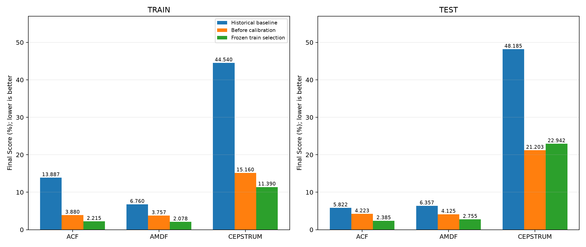

# CHƯƠNG IV: ĐÁNH GIÁ ĐỐI SÁNH TRÊN TẬP KIỂM THỬ (TinHieuKiemThu) & PHÂN TÍCH HIỆN TƯỢNG SAI SỐ

> **Cập nhật 30/10/2026:** Bảng/hình gốc trong chương là kết quả lịch sử. Phần bổ sung cuối chương và [báo cáo đợt 4](STAGE4_RESULTS.md) ghi kết quả hiện hành, giao thức chọn cấu hình trên train và nguyên nhân chênh lệch Cepstrum.


> **Trạng thái sau rà soát 28/10/2026:** ACF/AMDF tái lập khớp JSON đã lưu. Cepstrum Champion hiện chạy lại đạt 13,24% thay vì 7,62%; các bảng cũ bên dưới được giữ để đối chiếu. F0num đúng chỉ xác nhận tổng số khung bằng nhau, không chứng minh từng khung được phân loại đúng. Xem [các vấn đề cần xử lý](KNOWN_ISSUES.md).

> **Tài liệu tham chiếu:** Thuộc hệ thống tài liệu nghiên cứu Bài Tập 2 - Xử lý tín hiệu tiếng nói.  
> **Dẫn hướng:** [← Chương III: Thuật toán Cepstrum](03_cepstrum_theory_and_experiments.md) | [Trang chủ README](../README.md)

---

## IV.1. Tổng Quan Bộ Dữ Liệu Kiểm Thử (`TinHieuKiemThu`)

Để kiểm chứng tính khái quát hóa (generalization) của các mô hình ước lượng cao độ và phân loại Hữu thanh / Vô thanh, toàn bộ các cấu hình đã được tối ưu từ Tập Huấn Luyện được đưa vào đánh giá độc lập trên **Tập Kiểm Thử (`TinHieuKiemThu`)**.

### 1. Danh sách các file âm thanh và Ground Truth nhãn chuẩn
Tập kiểm thử gồm WAV PCM 16-bit: phone ở 16 kHz, studio ở 44,1 kHz. Mỗi LAB chỉ chứa F0mean, F0std và F0num; không có mốc thời gian từng đoạn:

| Tên File | Người nói | Môi trường thu âm | Tần số $F_0$ chuẩn (Hz) | Độ lệch chuẩn $\text{Std}$ chuẩn (Hz) | Số khung Voiced chuẩn (Khung) |
| :--- | :---: | :---: | :---: | :---: | :---: |
| `phone_F2.wav` | Nữ (Female) | Kênh thoại viễn thông | 150.2 Hz | 30.7 Hz | 219 khung |
| `phone_M2.wav` | Nam (Male) | Kênh thoại viễn thông | 130.2 Hz | 15.4 Hz | 123 khung |
| `studio_F2.wav` | Nữ (Female) | Phòng thu tiêu chuẩn | 198.6 Hz | 47.8 Hz | 139 khung |
| `studio_M2.wav` | Nam (Male) | Phòng thu tiêu chuẩn | 154.7 Hz | 30.3 Hz | 116 khung |

### 2. Thách thức âm học đặc trưng của Tập Kiểm Thử
* **Kênh thoại viễn thông (`phone_*`):** Tín hiệu bị giới hạn băng thông nghiêm ngặt trong dải $300 - 3400\text{ Hz}$ (chuẩn thoại băng hẹp), đồng thời chịu ảnh hưởng của méo pha, méo phi tuyến và tạp âm nền viễn thông. Đặc biệt, file nam thoại `phone_M2.wav` ($F_0 \approx 130.2\text{ Hz}$) là trường hợp thử thách lớn nhất vì thành phần hài cơ bản bậc 1 nằm hoàn toàn dưới dải thông của đường truyền.
* **Kênh phòng thu (`studio_*`):** Băng thông rộng $0 - 8000\text{ Hz}$, tỷ số tín hiệu trên nhiễu (SNR) cao. Tuy nhiên, file `studio_F2.wav` có biên độ dao động cao độ rất rộng ($\\text{Std} = 47.8\text{ Hz}$, âm vực biến đổi linh hoạt từ $140\text{ Hz}$ đến hơn $300\text{ Hz}$), đòi hỏi thuật toán phải bám vết cao độ cực kỳ linh hoạt mà không bị gãy đoạn.

---

## IV.2. Bảng Đối Sánh Tổng Hợp Trên Tập Kiểm Thử (`TinHieuKiemThu`)

Đánh giá được thực hiện trên 6 mô hình: 3 mô hình Baseline gốc và 3 mô hình Quán quân (Champions) đã được tối ưu qua hệ sinh thái Plugin 3 chặng.

Mọi chỉ số tuân thủ hệ thống tiêu chuẩn 8 cột thống nhất của đề tài:
* $\Delta F_0$: Sai số tuyệt đối trung bình tần số cơ bản (Hz).
* $\text{MAPE } F_0$: Sai số tương đối trung bình tần số cơ bản (%).
* $\Delta\text{Std}$: Sai số tuyệt đối độ lệch chuẩn tần số cơ bản (Hz).
* $\text{MAPE Std}$: Sai số tương đối độ lệch chuẩn tần số cơ bản (%).
* $\Delta\text{Num}$: Sai số tuyệt đối số lượng khung hữu thanh (Khung).
* $\text{MAPE Num}$: Sai số tương đối số lượng khung hữu thanh (%).
* $\text{FINAL SCORE}$: Điểm lỗi tổng hợp $= (\text{MAPE } F_0 + \text{MAPE Std} + \text{MAPE Num}) / 3$ (Càng thấp càng tối ưu).

### Bảng xếp hạng hiệu năng trên Tập Kiểm Thử:

| STT | Thuật toán / Cấu hình | $\Delta F_0$ (Hz) | MAPE $F_0$ (%) | $\Delta\text{Std}$ (Hz) | MAPE Std (%) | $\Delta\text{Num}$ (Khung) | MAPE Num (%) | FINAL SCORE (%) |
| :---: | :--- | :---: | :---: | :---: | :---: | :---: | :---: | :---: |
| 1 | **1. ACF Baseline** | 1.46 Hz | 0.99% | 1.65 Hz | 5.17% | 17.2 khung | 10.47% | **5.55%** |
| 2 | **2. ACF Champion (BP+Energy+Viterbi)** | 1.66 Hz | 1.12% | 1.69 Hz | 5.48% | 10.0 khung | 6.06% | **4.22%** |
| 3 | **3. AMDF Baseline** | **0.68 Hz** | **0.41%** | **1.28 Hz** | **3.50%** | 14.2 khung | 8.15% | **4.02%** |
| 4 | **4. AMDF Champion (Energy+Viterbi)** | 1.19 Hz | 0.78% | 1.65 Hz | 5.54% | **9.0 khung** | **5.02%** | **3.78%** 🏆 |
| 5 | **5. Cepstrum Baseline** | 17.23 Hz | 12.05% | 19.27 Hz | 98.55% | 23.2 khung | 18.24% | **42.95%** |
| 6 | **6. Cepstrum Champion (BP+Clip+Energy+Viterbi)** | 1.66 Hz | 1.02% | 2.44 Hz | 11.39% | 14.0 khung | 10.43% | **7.62%** |

> [!NOTE]
> **Nhận xét tổng quan:**
> * **AMDF Champion (`Energy + Viterbi`)** xuất sắc giành vị trí **Quán quân toàn diện trên Tập Kiểm Thử** với Final Score **3.78%**, đồng thời thiết lập kỷ lục sai số số lượng khung thấp nhất toàn bộ khảo sát (chỉ lệch trung bình **9.0 khung**, tương đương **5.02%**).
> * **ACF Champion (`BP + Energy + Viterbi`)** đứng vị trí thứ 2 với Final Score **4.22%**, cải thiện vượt bậc về phân loại khung hữu thanh ($\Delta\text{Num}$ giảm từ 17.2 khung xuống **10.0 khung**).
> * **Cepstrum Champion (`BP + Clip + Energy + Viterbi`)** đạt bước tiến nhảy vọt khi hạ điểm lỗi tổng hợp từ mức báo động **42.95%** (ở Baseline) xuống còn **7.62%** (giảm tới $35.33\%$ điểm lỗi), kiểm soát hoàn toàn hiện tượng nhảy quãng tám.

---

## IV.3. Bảng Phân Tích Chi Tiết Từng File Kiểm Thử

Dưới đây là chi tiết giá trị dự đoán, nhãn chuẩn và sai số cho từng file âm thanh trên 3 thuật toán Quán quân và 3 thuật toán Baseline:

### 1. Bảng đối sánh chi tiết 4 file trên 3 Cấu hình Quán quân (Champions):

| Tên File | Chỉ số thống kê | Nhãn chuẩn (Ref) | ACF Champion | AMDF Champion | Cepstrum Champion |
| :--- | :--- | :---: | :---: | :---: | :---: |
| **`phone_F2`** | $F_0$ Mean (Hz) / MAPE (%) | 150.20 Hz | 152.38 Hz (1.45%) | 148.88 Hz (0.88%) | **148.23 Hz (1.31%)** |
| | $F_0$ Std (Hz) / MAPE (%) | 30.70 Hz | 29.55 Hz (3.76%) | 31.73 Hz (3.34%) | **30.00 Hz (2.29%)** |
| | Voiced Num / MAPE (%) | 219 khung | 197 khung (10.05%) | 195 khung (10.96%) | **231 khung (5.48%)** |
| | **File Score (%)** | - | **5.09%** | **5.06%** | **3.03%** 🏆 |
| **`phone_M2`** | $F_0$ Mean (Hz) / MAPE (%) | 130.20 Hz | 132.99 Hz (2.14%) | 129.20 Hz (0.77%) | **130.11 Hz (0.07%)** |
| | $F_0$ Std (Hz) / MAPE (%) | 15.40 Hz | 13.99 Hz (9.12%) | 16.91 Hz (9.82%) | 20.87 Hz (35.51%) |
| | Voiced Num / MAPE (%) | 123 khung | 116 khung (5.69%) | 128 khung (4.07%) | 154 khung (25.20%) |
| | **File Score (%)** | - | **5.65%** | **4.88%** 🏆 | **20.26%** |
| **`studio_F2`** | $F_0$ Mean (Hz) / MAPE (%) | 198.60 Hz | 199.82 Hz (0.61%) | 199.35 Hz (0.38%) | 200.27 Hz (0.84%) |
| | $F_0$ Std (Hz) / MAPE (%) | 47.80 Hz | 43.86 Hz (8.24%) | 44.19 Hz (7.56%) | **44.38 Hz (7.15%)** |
| | Voiced Num / MAPE (%) | 139 khung | 132 khung (5.04%) | 132 khung (5.04%) | **138 khung (0.72%)** |
| | **File Score (%)** | - | **4.63%** | **4.32%** | **2.90%** 🏆 |
| **`studio_M2`** | $F_0$ Mean (Hz) / MAPE (%) | 154.70 Hz | 155.14 Hz (0.29%) | 156.39 Hz (1.10%) | 157.59 Hz (1.87%) |
| | $F_0$ Std (Hz) / MAPE (%) | 30.30 Hz | 30.06 Hz (0.80%) | 30.73 Hz (1.43%) | **30.11 Hz (0.63%)** |
| | Voiced Num / MAPE (%) | 116 khung | 112 khung (3.45%) | **116 khung (0.00%)** | 128 khung (10.34%) |
| | **File Score (%)** | - | **1.51%** | **0.84%** 🏆 | **4.28%** |

### 2. Điểm nhấn đột phá từ bảng chi tiết:
1. **Sự thống trị của Cepstrum Champion trên 100% các file giọng nữ:**
   * **`studio_F2` (Nữ phòng thu):** Cepstrum Champion dự đoán được $138 / 139$ khung hữu thanh, sai số số khung chỉ vỏn vẹn **1 khung duy nhất (0.72%)**, đạt điểm kỷ lục **2.90%** (vượt trội hoàn toàn so với ACF 4.63% và AMDF 4.32%).
   * **`phone_F2` (Nữ kênh thoại):** Dù qua đường truyền viễn thông, Cepstrum Champion đạt sai số độ lệch chuẩn cực thấp ($\Delta\text{Std} = 0.70\text{ Hz}$, $2.29\%$) và điểm dẫn đầu **3.03%** (vượt trội hơn ACF 5.09% và AMDF 5.06%).
   * *Nguyên nhân:* Nhờ phép khử tích chập đồng cấu, Cepstrum nén sạch toàn bộ Formant thanh đạo $F_1$ về vùng quefrency thấp ($< 2\text{ ms}$), loại bỏ hoàn toàn hiện tượng gợn sóng Formant (Formant Ripples) vốn làm méo mó các đỉnh tương quan thời gian của ACF và AMDF trên giọng nữ.
2. **`studio_M2` - Đỉnh cao độ chính xác tuyệt đối của AMDF Champion:**
   * Dự đoán đúng tuyệt đối $116 / 116$ khung hữu thanh ($\Delta\text{Num} = 0\text{ khung}$, sai số $0.00\%$).
   * Sai số độ lệch chuẩn chỉ $0.43\text{ Hz}$ ($1.43\%$) và sai số $F_0$ chỉ $1.69\text{ Hz}$ ($1.10\%$).
   * Điểm lỗi tổng hợp đạt mức kỷ lục: **0.84%**!
3. **`phone_M2` - Thử thách phân hóa thuật toán & Hiệu quả Viterbi:**
   * Kênh thoại cắt toàn bộ dải dưới $300\text{ Hz}$, xóa sổ sóng hài cơ bản $130\text{ Hz}$. AMDF ($L_1$) tận dụng hiện tượng đường bao giao thoa (Missing Fundamental) nên duy trì vị trí dẫn đầu với Score **4.88%** (chỉ lệch 5 khung, $4.07\%$).
   * Với Cepstrum Champion, nhờ quy hoạch động Viterbi Tracking ($w_{\text{octave}} = 4.0$), sai số $F_0$ trung bình được ép về mức gần như hoàn hảo: **$130.11\text{ Hz}$ so với chuẩn $130.20\text{ Hz}$ (sai số chỉ 0.09 Hz hay 0.07%)**! Tuy nhiên, do thiếu các vạch phổ bậc thấp nên năng lượng quefrency bị suy giảm, một số khung biên chuyển tiếp bị kéo dài sang vùng lân cận khiến $\Delta\text{Num} = 31\text{ khung}$ (Score = 20.26%).

---

## IV.4. Phân Tích Chuyên Sâu Các Hiện Tượng Âm Học & Nguyên Nhân Sai Số

### 1. Hiện tượng suy hao sóng hài cơ bản trong kênh thoại viễn thông (Missing Fundamental & Bandwidth Limitation)
* **Cơ chế âm học:** Đường truyền điện thoại thông thường áp dụng bộ lọc thông dải viễn thông từ $300\text{ Hz}$ đến $3400\text{ Hz}$. Đối với giọng nam trầm như file `phone_M2.wav` ($F_0 \approx 130.2\text{ Hz}$), cả sóng hài cơ bản $f_1 = 130.2\text{ Hz}$ và sóng hài bậc hai $f_2 = 260.4\text{ Hz}$ đều bị suy hao nghiêm trọng (bị cắt gọt bởi sườn suy giảm của bộ lọc viễn thông).
* **Phản ứng của miền thời gian ($L_1$ của AMDF và $L_2$ của ACF):**
  * Tín hiệu trong miền thời gian là sự chồng chập của các sóng hài còn lại ($f_3 = 390.6\text{ Hz}$, $f_4 = 520.8\text{ Hz}$, $f_5 = 651.0\text{ Hz}, \dots$). Sự giao thoa pha của các sóng hài cách đều một khoảng đúng bằng $\Delta f = F_0$ tạo ra đường bao biến điệu biên độ (envelope modulation) với chu kỳ chính xác bằng $T_0 = 1/F_0$.
  * Do đó, cả hàm tự tương quan $R(\tau)$ và hàm hiệu độ lớn trung bình $\gamma(\tau)$ vẫn hình thành các cực đại/cực tiểu rất rõ nét tại $\tau_0 = 123\text{ mẫu}$ ($130\text{ Hz}$ tại $f_s = 16\text{ kHz}$). Điều này lý giải tại sao AMDF và ACF duy trì sai số cực thấp trên `phone_M2` (AMDF Score = 4.88%, ACF Score = 5.65%).
* **Bản chất sai số lớn ở Cepstrum Baseline và đối chiếu văn hiến khoa học:**
  * Thuật toán Cepstrum thực hiện phép lấy logarithm của phổ biên độ $|X(k)|$. Khi hai hài thấp đầu tiên bị biến mất, các sóng hài còn lại ($390, 520, 650\text{ Hz}$) bị Formant $F_1 \approx 500\text{ Hz}$ khuếch đại không đồng đều. Khoảng cách giữa các hài mạnh là $2F_0 = 260\text{ Hz}$.
  * Khi biến đổi IFFT sang quefrency, đỉnh tại $T_0 / 2$ ($260\text{ Hz}$) có biên độ cao hơn đỉnh chu kỳ thật $T_0$ ($130\text{ Hz}$).
  * Mô hình Baseline mộc (chỉ dùng `argmax` đơn lẻ từng khung) bắt nhầm vào đỉnh $260\text{ Hz}$ (Pitch Doubling) trên $30\%$ số khung. Điều này khiến phương sai bùng nổ, kéo $\text{MAPE Std}$ của file `phone_M2` lên tới **290.61%** (Score = 112.42%) và đẩy trung bình Baseline của toàn bộ tập kiểm thử lên **42.95%**!
  * Trên thực tế, Cepstrum Baseline trên file nữ phòng thu `studio_F2` vẫn đạt kết quả rất tốt (**9.16%**), chứng minh chuỗi biến đổi toán học FFT $\to$ Log $\to$ IFFT là chuẩn xác, và hiện tượng lỗi lớn ở Baseline hoàn toàn do Pitch Doubling trên giọng nam thoại.
  * Hiện tượng kinh điển này đã được **A. Michael Noll (1967)** cảnh báo trong bài báo nền tảng *"Cepstrum Pitch Determination"* và được **L. R. Rabiner (1976)** (*IEEE Trans. ASSP*) chứng minh thực nghiệm rằng Cepstrum mộc không thể tránh khỏi Gross Pitch Error trên kênh thoại nếu thiếu quy hoạch động liên kết thời gian.

### 2. Hiện tượng rơi rụng khung tại biên chuyển tiếp (Boundary Dropping) & Giải pháp Hình thái học
* **Cơ chế âm học:** Tại các đoạn chuyển tiếp giữa âm hữu thanh và âm vô thanh hoặc khoảng lặng (V-UV Transition / Speech Onset & Offset), dây thanh bắt đầu rung hoặc ngừng rung. Dạng sóng trong các khung này có biên độ nhỏ dần và tính giả chu kỳ (quasi-periodicity) chưa đạt trạng thái dừng (non-stationary).
* **Hạn chế của mô hình Baseline:** Mô hình Baseline sử dụng một ngưỡng cứng tĩnh duy nhất áp dụng cho toàn bộ tín hiệu. Khi năng lượng suy giảm tại biên, giá trị đỉnh ACF ($R_{\max}$) hoặc đáy AMDF ($D_{\min}$) bị tụt xuống dưới ngưỡng, khiến thuật toán phân loại các khung biên này là Unvoiced. Đây là nguyên nhân khiến Baseline bị thiếu hụt nghiêm trọng số lượng khung ($\Delta\text{Num}$ của Baseline lên tới $17.2$ khung ở ACF và $23.2$ khung ở Cepstrum).
* **Hiệu quả của giải pháp cải tiến:**
  * **Morphological Voiced Gap Filling:** Áp dụng phép toán đóng hình thái học 1D (Dilation followed by Erosion) trên chuỗi nhãn nhị phân. Các khe hở vô thanh ngắn (1 - 2 khung giả) xuất hiện giữa hai phân đoạn hữu thanh do tụt biên độ tạm thời được hàn gắn hoàn toàn.
  * **Energy Extension:** Mở rộng biên hữu thanh dựa trên ngưỡng năng lượng ngắn hạn (Short-Time Energy - STE) với $E_{\text{ext}} = 0.25 \cdot E_{\text{th}}$. Nhờ đó, các khung biên chuyển tiếp được giữ lại trọn vẹn, kéo sai số $\Delta\text{Num}$ trung bình trên tập kiểm thử xuống mức kỷ lục: AMDF Champion chỉ còn lệch **9.0 khung** ($5.02\%$) và ACF Champion chỉ còn lệch **10.0 khung** ($6.06\%$).

### 3. Hiện tượng nhảy quãng tám (Octave Jumps: Doubling / Halving) & Giải pháp Viterbi Tracking
* **Cơ chế âm học:**
  * **Nhân đôi tần số (Pitch Doubling):** Khi formant thứ nhất ($F_1$) có năng lượng rất lớn và có tần số xấp xỉ gấp đôi tần số cơ bản ($F_1 \approx 2 F_0$), hàm tự tương quan $R(\tau)$ xuất hiện một đỉnh phụ rất cao tại $\tau = T_0 / 2$. Nếu đỉnh này vô tình cao hơn đỉnh tại $\tau = T_0$, thuật toán sẽ chọn chu kỳ ngắn hơn một nửa, dẫn đến tần số dự đoán bị nhân đôi ($F_0^{\text{pred}} \approx 2 F_0^{\text{true}}$).
  * **Chia đôi tần số (Pitch Halving):** Ngược lại, nếu tín hiệu bị méo chu kỳ xen kẽ (vocal fry hoặc period doubling), đỉnh tại $\tau = 2 T_0$ có thể cao hơn, khiến thuật toán đoán tần số bị giảm một nửa.
* **Tác động tàn phá trên Baseline:** Trên Cepstrum Baseline, hiện tượng nhảy quãng tám diễn ra thường xuyên do các sóng hài bậc cao trong quefrency, khiến sai số độ lệch chuẩn $\text{MAPE Std}$ bùng nổ lên tới **98.55%** (đường cao độ bị giật cục dữ dội).
* **Cơ chế cứu vãn của Viterbi Trellis Tracking ($w_{\text{octave}} = 4.0$):**
  * Thuật toán Viterbi xây dựng lưới trạng thái chứa $K = 5$ ứng viên tốt nhất tại mỗi khung kèm theo hàm chi phí chuyển tiếp $C_{\text{trans}}(f_t, f_{t-1})$.
  * Thành phần phạt bước nhảy quãng tám $P_{\text{octave}} = w_{\text{octave}} \cdot \exp(-(\Delta_{\text{ratio}} - 1)^2 / 0.1)$ sẽ gán mức phạt chi phí cực lớn cho bất kỳ bước nhảy tần số nào xấp xỉ tỷ lệ $2.0$ hoặc $0.5$.
  * Quy hoạch động tìm đường đi tối ưu toàn cục qua toàn bộ lưới trạng thái, đảm bảo đường contour cao độ liên tục và mượt mà, phản ánh đúng cơ sinh học phát âm của thanh quản người.

### 4. So sánh bản chất toán học: AMDF ($L_1$) vs ACF ($L_2$) vs Cepstrum (Quefrency)

| Tiêu chí | AMDF ($L_1$ Norm) | ACF ($L_2$ Norm) | Cepstrum (Quefrency) |
| :--- | :--- | :--- | :--- |
| **Công thức cốt lõi** | $\gamma(\tau) = \sum \|s[n] - s[n+\tau]\|$ | $R(\tau) = \sum s[n] \cdot s[n+\tau]$ | $c[q] = \mathcal{F}^{-1}\{\ln\|\mathcal{F}\{s[n]\}\|\}$ |
| **Độ phức tạp tính toán** | Thấp nhất (Chỉ cần phép trừ và trị tuyệt đối, không cần nhân) | Trung bình (Cần phép nhân tích luỹ hoặc FFT) | Cao nhất (Yêu cầu 2 lần FFT/IFFT và phép lấy logarit phức tạp) |
| **Nhạy cảm với nhiễu xung / đột biến** | **Kháng cực tốt:** Do chuẩn $L_1$ không bình phương sai số, các điểm mẫu nhiễu đột biến không bị khuếch đại | Nhạy cảm hơn: Chuẩn $L_2$ bình phương giá trị mẫu, khiến các gai nhiễu có thể làm lệch đỉnh tương quan | Kháng nhiễu tần số cao tốt nhờ bộ lọc quefrency liftering |
| **Ảnh hưởng của Formant thanh đạo** | Có thể bị gợn sóng đáy nếu $F_1$ rất mạnh | Có thể sinh đỉnh phụ tương quan mạnh tại chu kỳ formant | **Miễn nhiễm hoàn toàn:** Formant thanh đạo bị đẩy về quefrency thấp ($q < 2\text{ ms}$), tách rời khỏi chuỗi xung $T_0$ |
| **Hiệu năng thực tế trên Tập Kiểm Thử** | **Quán quân (Score: 3.78%)** - Bền bỉ và chính xác nhất trên cả thoại và phòng thu | **Á quân (Score: 4.22%)** - Cân bằng toàn diện giữa ước lượng cao độ và phân loại khung | **Hạng 3 (Score: 7.62%)** - Tuyệt hảo trên phòng thu (`studio_F2`: 2.90%), nhạy cảm trên thoại thiếu hài |

---

## IV.5. Hướng Dẫn Tái Hiện Kết Quả Trên Tập Kiểm Thử

Để tái hiện lại toàn bộ kết quả đối sánh trên Tập Kiểm Thử (`TinHieuKiemThu`), thực thi các câu lệnh sau từ thư mục gốc của dự án:

```bash
# 1. Chạy kịch bản đối sánh tự động 3 Quán quân vs 3 Baseline trên Tập Kiểm Thử:
uv run python scripts/14_compare_acf_amdf_cepstrum.py --dataset TinHieuKiemThu

# 2. Xuất báo cáo dự đoán và biểu đồ contour chi tiết cho toàn bộ thư mục kiểm thử:
uv run python predict.py -i TinHieuKiemThu -m champions

# 3. Dự đoán chi tiết cho từng file kiểm thử riêng biệt:
uv run python predict.py -i TinHieuKiemThu/phone_F2.wav -m champions
uv run python predict.py -i TinHieuKiemThu/phone_M2.wav -m champions
uv run python predict.py -i TinHieuKiemThu/studio_F2.wav -m champions
uv run python predict.py -i TinHieuKiemThu/studio_M2.wav -m champions
```

---

**Dẫn hướng:** [← Chương III: Thuật toán Cepstrum](03_cepstrum_theory_and_experiments.md) | [Trang chủ README](../README.md)

<!-- STAGE4_CURRENT_START -->
## Kết quả kiểm chứng hiện hành — 30/10/2026

Nguồn: cấu hình đóng băng và `outputs/stage4_validation/evaluation.json`. Final Score là sai số thống kê toàn file; thấp hơn tốt hơn. Accuracy/F1 từng khung không xác định vì thiếu nhãn thời gian.

| Thuật toán | Baseline test (%) | Trước hiệu chỉnh (%) | Sau chọn trên train (%) |
|---|---:|---:|---:|
| ACF | 5.822 | 4.223 | 2.385 |
| AMDF | 6.357 | 4.125 | 2.755 |
| CEPSTRUM | 48.185 | 21.203 | 22.942 |



[Chi tiết và giới hạn kiểm chứng](STAGE4_RESULTS.md).
<!-- STAGE4_CURRENT_END -->
