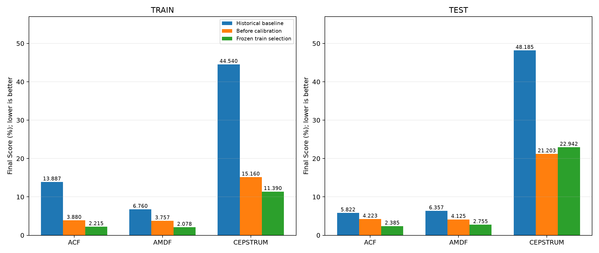
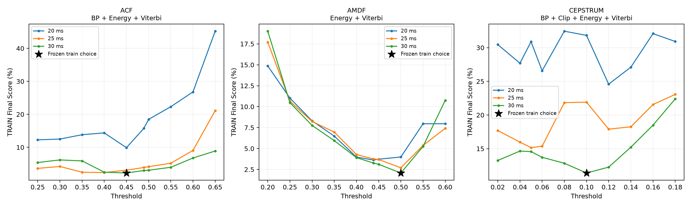
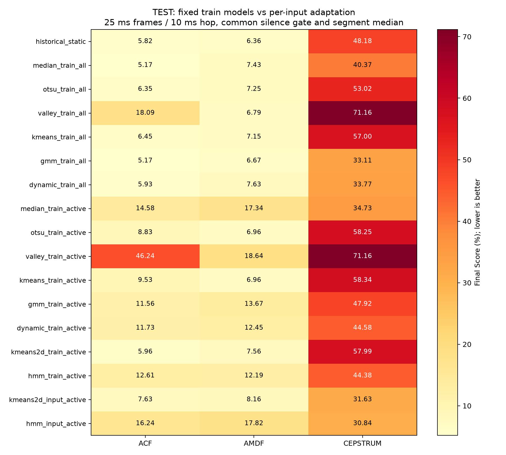

# Đợt 4 — Kiểm chứng và hiệu chỉnh trên train

> Cập nhật 01/11/2026: đây là kết quả Stage 4 đã lưu. Snapshot nguồn đã được phục dựng đúng checksum của lần tạo lại ngày 31/10; bản snapshot/runtime/validation ngày 30/10 được giữ riêng. Các điểm/giao thức cũ không tự thay đổi khi sửa Otsu. Xem [rà soát main](MAIN_REVIEW_FIXES.md) và [benchmark 15/16 sau sửa](../outputs/main_review_2026-11-01/README.md).

<!-- STAGE4_REPORT_START -->
Ngày 30/10/2026. Kết quả sinh từ `scripts/19_report_validation.py`, cấu hình đóng băng và dữ liệu đánh giá đã lưu.

## Phạm vi và giao thức

- Khảo sát 222 cấu hình, 888 lượt cấu hình/file trên bốn WAV train.
- Pha 1: đủ 16 tổ hợp BP/Clip/Energy/Viterbi ở cấu hình lịch sử. Pha 2: hai tổ hợp tốt nhất cộng Champion lịch sử, khung 20/25/30 ms và lưới ngưỡng định trước.
- Hop cố định 10 ms, F0 70–400 Hz, clipping 40%, hệ số Energy/Viterbi giữ nguyên. Không khẳng định đã tìm tối ưu toàn bộ không gian tham số.
- Tiêu chí: trung bình Final Score của bốn file train; hòa điểm ưu tiên sai số file tệ nhất, số plugin, khoảng cách tới khung 25 ms, tên plugin và ngưỡng.
- Dùng tham chiếu thống kê toàn file để hiệu chỉnh; không gọi đây là huấn luyện Gaussian từ nhãn V/UV. Accuracy/F1 từng khung vẫn không có.
- `frozen_config.json` và `frozen_models.json` có checksum, được ghi trước bước đọc/evaluate test. Các tham số không được chọn lại theo điểm test.
- Test từng được xem trong các lần rà soát trước; đây là lựa chọn theo train với cấu hình cố định khi đánh giá, không phải một test set hoàn toàn chưa từng được quan sát.

## Preset đã chốt

| Thuật toán | Plugin | Frame/hop (ms) | Ngưỡng | Train trước → sau | Test trước → sau |
|---|---|---:|---:|---:|---:|
| ACF | BP + Energy + Viterbi | 30/10 | 0.45 | 3.880 → 2.215 | 4.223 → 2.385 |
| AMDF | Energy + Viterbi | 30/10 | 0.5 | 3.757 → 2.078 | 4.125 → 2.755 |
| CEPSTRUM | BP + Clip + Energy + Viterbi | 30/10 | 0.1 | 15.160 → 11.390 | 21.203 → 22.942 |

**ACF và AMDF giảm sai số test; Cepstrum tăng sai số test dù giảm trên train.** Giữ preset đã chốt, không đảo lại sau khi xem test. Chỉ có bốn file train nên khả năng tổng quát còn hạn chế.





## Truy vết Cepstrum lịch sử

Replay commit `caaf751` đã tái lập đúng 4,43% train / 7,62% test trong artifact. Bộ đếm xác nhận 3247 lời gọi ACF và 0 lời gọi Cepstrum khi plugin detector báo method là Cepstrum.

Commit này thiếu nhánh `elif method == "cepstrum"` trong `src/plugins/plugin_detector.py`: ứng viên pitch và quyết định V/UV rơi vào nhánh ACF, sau đó hậu xử lý/Viterbi lại dùng Cepstrum. Kết quả cũ là một pipeline lai, không phải Cepstrum thuần theo mô tả.

Chỉ thay `plugin_detector.py` bằng bản có nhánh Cepstrum từ commit `427c0a4`, giữ mọi mã/dữ liệu khác, đổi số lời gọi thành ACF=0, Cepstrum=3247. Điểm thành 6,84% / 13,24%, khớp mốc trước sửa đợt 1.

Vì vậy không dùng 4,43%/7,62% làm mốc chất lượng Cepstrum đúng thuật toán. Các artifact cũ được giữ nguyên để truy vết; không phục hồi lỗi nhánh ACF để lấy lại điểm thấp.

## Đối chứng các giao thức không giám sát

Mọi dòng dưới dùng khung 25/10 ms, cùng silence gate, ứng viên F0 và median theo từng đoạn. `train_all` fit toàn bộ train có silence; `train_active` fit phần active của train. `input_active` fit riêng active từng file đầu vào; không dùng LAB để fit nhưng là thích nghi trên chính dữ liệu đánh giá. HMM giữ A/pi cố định và reset qua silence/file boundary. Ngưỡng động dùng GMM train và median/STE cục bộ, không ước lượng SNR.

| Giao thức | ACF test (%) | AMDF test (%) | Cepstrum test (%) |
|---|---:|---:|---:|
| historical_static | 5.822 | 6.357 | 48.185 |
| median_train_all | 5.170 | 7.425 | 40.370 |
| otsu_train_all | 6.350 | 7.255 | 53.017 |
| valley_train_all | 18.090 | 6.790 | 71.160 |
| kmeans_train_all | 6.453 | 7.152 | 57.000 |
| gmm_train_all | 5.170 | 6.665 | 33.108 |
| dynamic_train_all | 5.925 | 7.635 | 33.770 |
| median_train_active | 14.575 | 17.335 | 34.733 |
| otsu_train_active | 8.832 | 6.955 | 58.255 |
| valley_train_active | 46.245 | 18.640 | 71.160 |
| kmeans_train_active | 9.525 | 6.955 | 58.343 |
| gmm_train_active | 11.560 | 13.673 | 47.920 |
| dynamic_train_active | 11.730 | 12.450 | 44.578 |
| kmeans2d_train_active | 5.958 | 7.558 | 57.987 |
| hmm_train_active | 12.608 | 12.188 | 44.380 |
| kmeans2d_input_active | 7.635 | 8.165 | 31.635 |
| hmm_input_active | 16.240 | 17.825 | 30.843 |

Các dòng này là đối chứng mô tả; không dùng thứ hạng test để chọn lại preset. Mô hình 2D/HMM fit trên train có kết quả riêng với bản thích nghi theo input.



## Artifact và tái lập

- [Cấu hình đã đóng băng](../outputs/stage4_validation/frozen_config.json), [mô hình đã fit trên train](../outputs/stage4_validation/frozen_models.json).
- [Toàn bộ trial theo file](../outputs/stage4_validation/train/all_trials_per_file.csv), [16 tổ hợp mỗi thuật toán](../outputs/stage4_validation/train/plugin_sweep.json).
- [Đánh giá đầy đủ](../outputs/stage4_validation/evaluation.json), [pipeline theo file](../outputs/stage4_validation/evaluation_pipelines_per_file.csv), [giao thức theo file](../outputs/stage4_validation/evaluation_protocols_per_file.csv).
- [Replay gốc](../outputs/stage4_validation/cepstrum_trace.json), [replay chỉ sửa nhánh Cepstrum](../outputs/stage4_validation/legacy_with_cepstrum_branch/cepstrum_trace.json).
- `training_source_snapshot.tar.gz` chứa đúng source theo checksum lúc bắt đầu train; `runtime.json` ghi phiên bản thư viện. Base commit, branch, checksum WAV/LAB và mã đang dùng nằm trong provenance.

```powershell
.\.venv\Scripts\python.exe -B scripts/17_validate_and_calibrate.py train --output-dir outputs/stage4_recheck
.\.venv\Scripts\python.exe -B scripts/17_validate_and_calibrate.py evaluate --output-dir outputs/stage4_recheck
```

Lệnh train từ chối ghi đè freeze; evaluate kiểm tra checksum và dữ liệu train, từ chối ghi đè evaluation đã có. Cache chỉ lưu kết quả tính theo khung và cấu hình chính xác; mọi quyết định/hậu xử lý/DP vẫn chạy bình thường và đã được đối chiếu với đường không cache.

## Giới hạn còn lại

- Không có nhãn V/UV theo thời gian hoặc F0 chuẩn từng khung; Final Score chỉ đo thống kê toàn file.
- Kết quả tốt về mean/std/count không chứng minh đúng contour hoặc hết octave errors. Việc tự gán nhãn dữ liệu cũ không thể thay bằng chứng tham chiếu.
- Chưa có tập kiểm thử mới độc lập sau các vòng phát triển; chưa đủ cơ sở khẳng định preset tối ưu trên mọi giọng/môi trường.
- Word, slide và phép đo T0 thủ công là các đầu ra môn học riêng, chưa được tạo trong đợt sửa code này.
<!-- STAGE4_REPORT_END -->
