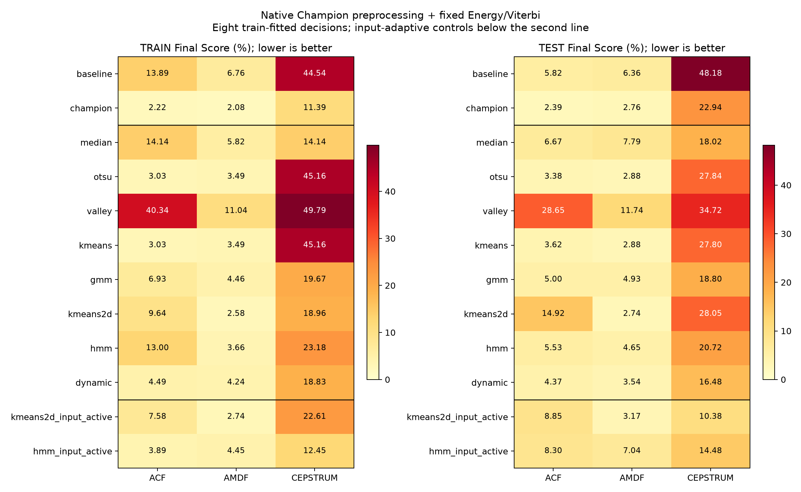

# Tám phương pháp không giám sát trong pipeline Champion

Kết quả sinh tự động từ freeze và evaluation. Ngày chạy: 2026-11-01T14:27:09.155053+00:00.

## Giao thức

- Không chọn lại Champion. Fit tám mô hình từ các khung active của bốn file train, sau đúng BP/Clipping và khung/hop của Champion.
- Median/Otsu/Valley/K-Means/GMM, chuẩn hóa/centroid 2D và Gaussian emission HMM được chốt trước test. HMM giữ A/pi cố định, reset qua silence và ranh giới file.
- ZCR được tính trên frame pitch đã tiền xử lý và bỏ DC. Ngưỡng động dùng GMM train, cửa sổ 50 khung/alpha 0,30 trong từng đoạn active; có dùng ngữ cảnh tương lai, không phải bộ giải mã realtime.
- Tất cả quyết định 30 ms dùng cùng silence gate, median, Energy, Viterbi. Ngưỡng periodicity của Energy cố định theo Champion; không đổi theo ngưỡng quyết định mới.
- Hai dòng input_active fit 2D/HMM trên từng input, được lưu mô hình riêng. Chúng không phải kết quả suy luận thuần từ mô hình train.
- Baseline là không plugin 25 ms; Champion và các dòng không giám sát dùng 30/10 ms. Final Score thấp hơn tốt hơn; chưa có nhãn thời gian để tính Accuracy/F1.
- Test đã được quan sát trong lịch sử. Các thứ hạng dưới chỉ mô tả; không dùng để chọn lại preset hoặc suy ra tỷ lệ V/UV 50/50.

## Đối sánh test

| Nhóm | Phương pháp | ACF (%) | AMDF (%) | Cepstrum (%) |
|---|---|---:|---:|---:|
| control | baseline | 5.822 | 6.357 | 48.185 |
| control | champion | 2.385 | 2.755 | 22.942 |
| train_fitted | median | 6.673 | 7.787 | 18.017 |
| train_fitted | otsu | 3.380 | 2.875 | 27.837 |
| train_fitted | valley | 28.652 | 11.740 | 34.718 |
| train_fitted | kmeans | 3.617 | 2.875 | 27.797 |
| train_fitted | gmm | 5.003 | 4.928 | 18.797 |
| train_fitted | kmeans2d | 14.920 | 2.735 | 28.047 |
| train_fitted | hmm | 5.535 | 4.647 | 20.717 |
| train_fitted | dynamic | 4.367 | 3.535 | 16.480 |
| input_adaptive | kmeans2d_input_active | 8.852 | 3.170 | 10.375 |
| input_adaptive | hmm_input_active | 8.303 | 7.045 | 14.482 |



## Tham số đã fit trên train

| Thuật toán | Plugin | Frame/hop (ms) | Champion / Energy guard | Median | Otsu | Valley | K-Means | GMM |
|---|---|---:|---:|---:|---:|---:|---:|---:|
| ACF | BP + Energy + Viterbi | 30/10 | 0.45 | 0.692230 | 0.572564 | 0.780229 | 0.574101 | 0.648525 |
| AMDF | Energy + Viterbi | 30/10 | 0.5 | 0.228717 | 0.359532 | 0.191470 | 0.361251 | 0.274803 |
| CEPSTRUM | BP + Clip + Energy + Viterbi | 30/10 | 0.1 | 0.145473 | 0.254098 | 0.312026 | 0.251127 | 0.179100 |

## Bằng chứng và giới hạn

- 288 kết quả từng file; 24 đối chứng Champion khớp từng label/time/F0 với đường chạy native.
- [frozen_config.json](frozen_config.json), [frozen_models.json](frozen_models.json) và SHA sidecar được tạo bởi pha train trước khi đọc test.
- [evaluation.json](evaluation.json), [per_file.csv](per_file.csv), `contours/`, `train_features/` và `input_models/` chứa đủ nguồn bảng và các quyết định trước/sau hậu xử lý.
- `training_source_snapshot.tar.gz` và `runtime.json` giữ mã/phiên bản đã dùng. Evaluate từ chối nếu source, pipeline hoặc dữ liệu train thay đổi sau freeze.
- Đây là giao thức mới có đặc trưng train/predict đồng nhất và Energy guard cố định. Không xem là tái lập giao thức chưa lưu của các mốc 14,31% / 14,40% / 2,17% trước đây.
- Chỉ có bốn train/bốn test. Điểm mean/std/count không chứng minh đúng contour hoặc hết lỗi octave; chưa có test mới độc lập.

```powershell
uv run python -B scripts/21_benchmark_champion_unsupervised.py train --output-dir outputs/champion_unsupervised_recheck
uv run python -B scripts/21_benchmark_champion_unsupervised.py evaluate --output-dir outputs/champion_unsupervised_recheck
uv run python -B scripts/21_benchmark_champion_unsupervised.py report --output-dir outputs/champion_unsupervised_recheck
```

Dùng thư mục mới khi chạy lại. Pha report chỉ ghi báo cáo/hình trong thư mục run.
