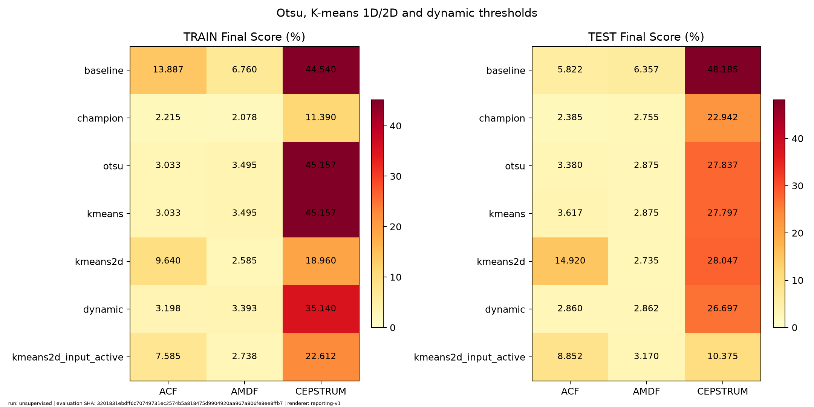

# Otsu, K-means 1D/2D và ngưỡng động

Ngày đánh giá: 2026-11-02T07:31:07.396544+00:00

## Giao thức

- ACF, AMDF và Cepstrum; khung 30 ms, hop 10 ms; vùng F0 70–400 Hz.
- Các dòng otsu/kmeans/kmeans2d/dynamic fit đặc trưng active trên train, đóng băng trước test. Không dùng LAB để fit.
- Dynamic dùng Otsu train làm ngưỡng nền, median cục bộ trong cửa sổ 50 khung, alpha 0,30, trọng số theo STE; không nối qua im lặng. Đây là xử lý offline.
- kmeans2d_input_active fit lại trên chính từng input và được báo cáo riêng.
- Giữ nguyên Champion: ACF dùng Bandpass + Energy + Viterbi; AMDF dùng Energy + Viterbi; Cepstrum dùng Bandpass + Center clipping + Energy + Viterbi. Baseline dùng 25/10 ms.
- Các quyết định mới dùng đúng tiền xử lý, median, Energy và Viterbi của Champion. Ngưỡng guard Energy giữ cố định 0,45 / 0,50 / 0,10; chỉ bộ quyết định mới được fit không giám sát.
- Final Score là trung bình ba sai số phần trăm F0mean/F0std/F0num rồi trung bình theo file; thấp hơn tốt hơn. LAB chỉ có thống kê nên Accuracy/F1 không xác định.
- Tập test đã được quan sát trước đây; không dùng thứ hạng để chọn lại cấu hình.

## TRAIN

| Phương pháp | ACF (%) | AMDF (%) | Cepstrum (%) |
|---|---:|---:|---:|
| baseline | 13.887 | 6.760 | 44.540 |
| champion | 2.215 | 2.078 | 11.390 |
| otsu | 3.033 | 3.495 | 45.157 |
| kmeans | 3.033 | 3.495 | 45.157 |
| kmeans2d | 9.640 | 2.585 | 18.960 |
| dynamic | 3.198 | 3.393 | 35.140 |
| kmeans2d_input_active | 7.585 | 2.738 | 22.612 |

## TEST

| Phương pháp | ACF (%) | AMDF (%) | Cepstrum (%) |
|---|---:|---:|---:|
| baseline | 5.822 | 6.357 | 48.185 |
| champion | 2.385 | 2.755 | 22.942 |
| otsu | 3.380 | 2.875 | 27.837 |
| kmeans | 3.617 | 2.875 | 27.797 |
| kmeans2d | 14.920 | 2.735 | 28.047 |
| dynamic | 2.860 | 2.862 | 26.697 |
| kmeans2d_input_active | 8.852 | 3.170 | 10.375 |

## Ngưỡng fit trên train

| Thuật toán | Otsu / nền dynamic | K-means 1D |
|---|---:|---:|
| acf | 0.572564 | 0.574101 |
| amdf | 0.359532 | 0.361251 |
| cepstrum | 0.254098 | 0.251127 |

## Kiểm chứng

- 168 kết quả từng file; 24 đối chứng khớp từng label/time/F0 với đường chạy trực tiếp.
- [CSV từng file](inputs/per_file.csv), [evaluation](inputs/evaluation.json), [cấu hình](inputs/retained_settings.json), [mô hình](inputs/retained_parameters.json).

Bản lưu số liệu; provenance cũ đã được loại khỏi bản xuất này.
