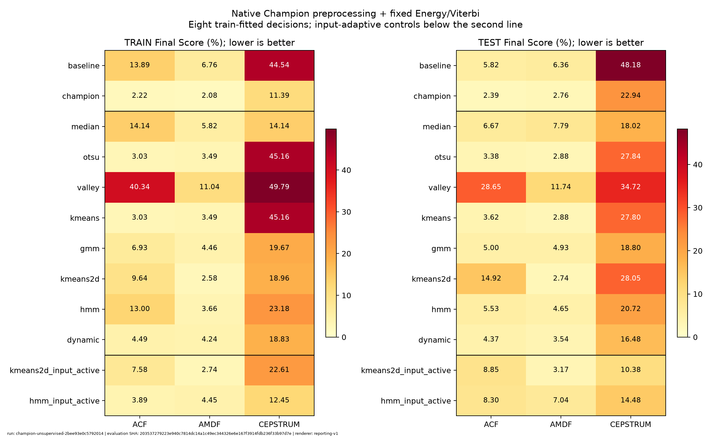
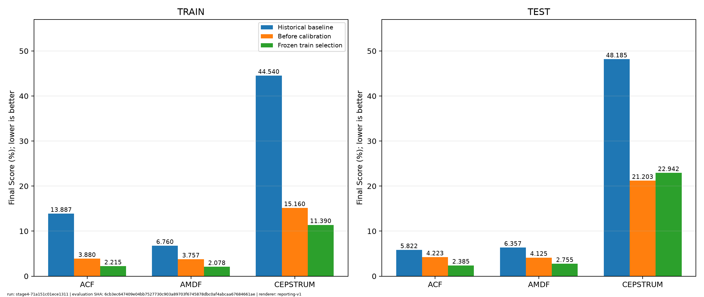
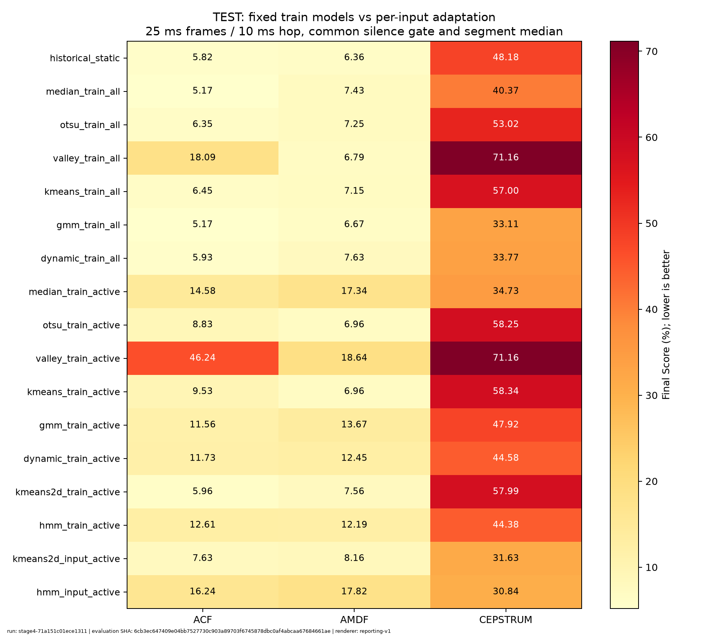
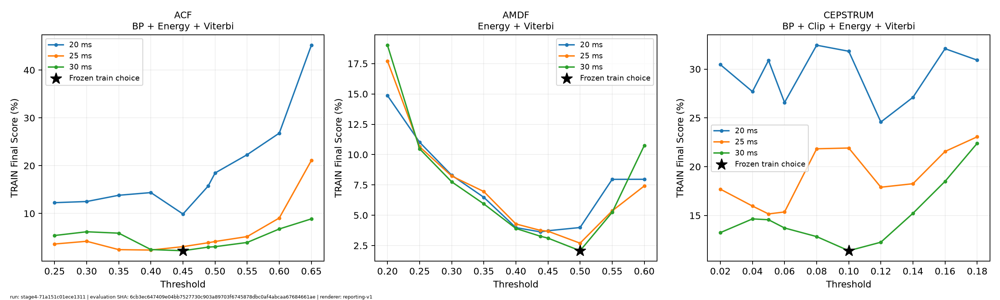

# Kiểm chứng reporting — refactor đợt 5

Nhánh `codex/refactor-reporting`, kế thừa đợt metric tại `7d62cda`. Không chạy detector, fit/chọn mô hình hoặc viết lại artifact lịch sử khi kiểm chứng reporting.

| Bằng chứng | Nội dung |
|---|---|
| [reference.json](reference.json) | Bảng/summary chụp bằng renderer gốc trên bản sao tạm trước refactor |
| [validation.json](validation.json) | 105 dòng bảng khớp, summary khớp, hai gói dựng lại độc lập, publish idempotent và byte thủ công giữ nguyên |
| [tests.json](tests.json) | 206 test đạt, source/test SHA |
| [stage4_report.tar.gz](stage4_report.tar.gz) | Gói Stage 4 đầy đủ bảng/hình/view/input/manifest/renderer snapshot |
| [champion_report.tar.gz](champion_report.tar.gz) | Gói Champion tương ứng |
| [publication_preview.diff](publication_preview.diff) | Diff đã apply và kiểm tra trên bản sao tạm; link phản ánh vị trí tạm lúc kiểm chứng |
| [source_snapshot.tar.gz](source_snapshot.tar.gz) | Byte nguồn của lần kiểm chứng và SHA trong validation |

Giải nén gói thành thư mục `stage4` hoặc `champion`, rồi chạy `python -B -m src.reporting verify <thu-muc>` hoặc `rebuild <thu-muc> --output <revision-moi>`. Manifest và liên kết trong gói không chứa đường tạm. Snapshot/metadata Git chỉ base trước commit; SHA nội dung xác định mã thực tế đã chạy.

```powershell
uv run python -B -m unittest discover -s tests
uv run python -B scripts/25_verify_reporting_refactor.py
```

Verify script mặc định chỉ đọc. Thêm `--output <thu-muc-proof-moi>` để lưu bộ mới, không thay reference hoặc proof hiện tại. Sáu hàm vẽ được chuyển nguyên AST; PNG không được dùng làm tiêu chí số học liên môi trường. Các bản PNG dưới đây sao đúng từ gói đã kiểm tra.









Chi tiết: [REPORTING.md](../../docs/REPORTING.md), [kế hoạch còn lại](../../docs/REFACTOR_PLAN.md).
